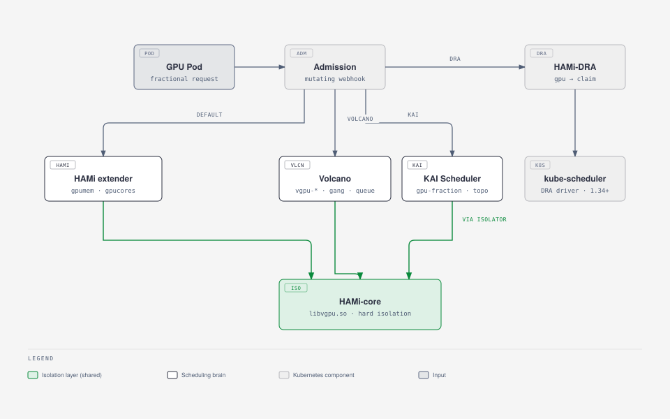
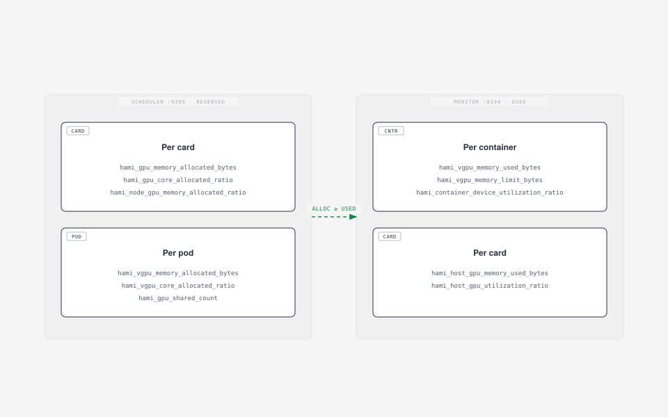

# ContainerDays 2026 Singapore: From Zero to Shared GPUs

This is the lab for the 45-minute workshop **From Zero to Shared GPUs: Hands-on GPU Scheduling in Kubernetes with HAMi**, ContainerDays 2026 Singapore, October 27, 12:30 to 13:15.

HAMi is a CNCF Incubating project for heterogeneous GPU virtualization in Kubernetes, supporting 10+ GPU/NPU vendors. In 45 minutes you take a bare kind cluster to a working GPU sharing setup, trace how a GPU request is intercepted, allocated and bound, then see how scheduler policies and other schedulers change the outcome, and where DRA fits.

Everything runs on your laptop. The real HAMi scheduler makes the decisions. The GPUs are fake:

- [mock-device-plugin](https://github.com/Project-HAMi/mock-device-plugin) turns a node annotation into `nvidia.com/gpumem` and `nvidia.com/gpucores` capacity.
- [hami-mock-monitor](https://github.com/fishman/hami-mock-monitor) produces HAMi's usage metrics (normally from vGPUmonitor and HAMi-core) from a load source instead of a GPU.

What you do **not** get without a GPU: memory and compute isolation inside the container. That part is HAMi-core, and the presenter shows it live on a real card.


Tested on 2026-10-20 with kind 0.33, kubectl 1.37, helm 4.3, HAMi chart 2.10.0 and hami-mock-monitor `86adb51`; Labs 2 and 3 (including `spread.yaml`) re-verified 2026-10-23.

## The 45 minutes

| Clock | Lab | What you walk away with |
| --- | --- | --- |
| 12:30 | Lab 1: Install HAMi | A kind cluster whose node advertises two fake A100s as vGPU capacity |
| 12:40 | Lab 2: Share a GPU | Fractional requests, the full interception chain, and a Pod that can never fit |
| 12:50 | Lab 3: Scheduler policies | binpack vs spread on the card axis, and where topology comes in |
| 13:00 | Lab 4: Beyond the default scheduler | How KAI Scheduler and Volcano compose with HAMi's isolation layer, and the DRA path |
| 13:10 | Wrap-up | Two metric families, what to try after the session |

## Before the session

- Laptop with Docker (or OrbStack / Colima), 4 CPU and 8 GB free
- `kind`, `kubectl`, `helm`, `jq`, `git`
- Go 1.27+ only if you want to build HAMi or contribute code (HAMi `go.mod` is `go 1.27.2`)
- A GitHub account

```bash
git clone https://github.com/Project-HAMi/hami-workshop
cd hami-workshop/examples/containerdays-singapore
git clone https://github.com/fishman/hami-mock-monitor
docker pull kindest/node:v1.37.0 busybox:1.36 ghcr.io/llm-d/llm-d-inference-sim:v0.12.0
```

Conference Wi-Fi is slow. Pull images at home.

## Lab 1: Install HAMi

```bash
./setup.sh
```

The script:

1. Creates a kind cluster `hami-lab` and labels the node `gpu=on`.
2. Installs HAMi 2.10.0 with the real device plugin off and the mock plugin on.
3. Fakes two A100-40GB cards. Two pieces are needed:
    - the count resource `nvidia.com/gpu=20` (the mock plugin's health gate, 2 cards x 10 splits)
    - the node annotation `hami.io/node-nvidia-register` from `fake-gpus.json`, which is what the real device plugin writes after it reads NVML
4. Builds and installs hami-mock-monitor with `completeBinds=true`.

Expected at the end:

```json
{ "nvidia.com/gpu": "20", "nvidia.com/gpucores": "200",
  "nvidia.com/gpumem": "81920", "nvidia.com/gpumem-percentage": "200" }
```

Look around:

```bash
kubectl -n kube-system get pods | grep hami
kubectl -n kube-system get cm hami-scheduler-device -o yaml | less
kubectl get node hami-lab-control-plane -o jsonpath='{.metadata.annotations.hami\.io/node-nvidia-register}' | jq
```

**Questions.** Where does the scheduler get the card list from? What would change if `health` was `false`?

## Lab 2: Share a GPU

```bash
kubectl apply -f share.yaml -f too-big.yaml
kubectl get pods -o wide
```

`share-1..3` run. `too-big` asks for 45000 MB, more than any 40960 MB card, and stays `Pending`:

```bash
kubectl get events --field-selector involvedObject.name=too-big | tail -2
# 0/1 nodes are available: 1 2/2 CardInsufficientMemory.
```

See what HAMi decided:

```bash
for p in share-1 share-2 share-3; do
  echo -n "$p "; kubectl get pod $p -o jsonpath='{.metadata.annotations.hami\.io/vgpu-devices-allocated}{"\n"}'
done
# share-1 GPU-mock-1,NVIDIA,15000,30:;
# share-2 GPU-mock-0,NVIDIA,15000,30:;
# share-3 GPU-mock-1,NVIDIA,15000,30:;
```

The format is `uuid,type,memory_mb,cores:` per device, `;` per container. The device plugin reads it in `Allocate`.

### The interception chain

You just watched the whole chain from request to card. Four steps, one node:

1. The admission **webhook** rewrites `schedulerName` to `hami-scheduler`.
2. The scheduler **extender** at `Filter` reads the node annotation `hami.io/node-nvidia-register` (the card list from Lab 1), checks memory and core headroom per card, and picks a physical card UUID.
3. At `Bind` it writes `hami.io/vgpu-devices-allocated` onto the Pod, sets `hami.io/bind-phase=allocating` and takes the node lock `hami.io/mutex.lock`.
4. The device plugin's `Allocate` mounts `/dev/nvidia*` and the vGPU files, reading the target from the Pod annotation, then marks `success` and releases the lock. The mock plugin skips this second step, which is why `completeBinds` in hami-mock-monitor exists. Without it the next Pod waits up to 5 minutes for the lock.

On a real node, step 4 also injects `libvgpu.so` via `ld.so.preload`, and HAMi-core enforces the memory and core limits from that moment on.

## Lab 3: Scheduler policies

Placement happens on two axes, and HAMi exposes each as a Pod annotation:

| Axis | Annotation | binpack | spread |
| --- | --- | --- | --- |
| Which node | `hami.io/node-scheduler-policy` | fewer nodes | across nodes |
| Which card on that node | `hami.io/gpu-scheduler-policy` | same card | across cards |

Both axes score cards by utilization ratios: binpack prefers the fuller card (consolidation), spread prefers the emptier one (dispersion). This lab has one node, so the node axis has a single candidate. The card axis is fully observable on the two fake A100s:

```bash
kubectl delete -f share.yaml -f too-big.yaml
kubectl apply -f binpack.yaml
for p in pack-1 pack-2; do
  echo -n "$p "; kubectl get pod $p -o jsonpath='{.metadata.annotations.hami\.io/vgpu-devices-allocated}{"\n"}'
done
```

Both Pods report the same `GPU-mock-X`: two workloads sharing one card. Now the opposite:

```bash
kubectl delete -f binpack.yaml
kubectl apply -f spread.yaml
for p in spread-1 spread-2; do
  echo -n "$p "; kubectl get pod $p -o jsonpath='{.metadata.annotations.hami\.io/vgpu-devices-allocated}{"\n"}'
done
```

One Pod per card. Same cluster, same requests, different policy, different placement.

**Topology awareness.** The allocation annotation names an exact card UUID, and card choice is a topology decision: on a multi-GPU node it decides NVLink and PCIe locality. `fake-gpus.json` carries a `numa` field per card, the same hint the real device plugin records from the driver. Card-level spread keeps Pods on separate cards, binpack packs them onto one. Explicit topology-aware placement across cards and nodes is what the schedulers in the next lab add.

## Lab 4: Beyond the default scheduler

HAMi is two things: a capacity model (the extended resources plus the scheduler extender you just used) and HAMi-core, the isolation library. Other schedulers can replace the placement brain and keep the isolation layer:



**KAI Scheduler** is NVIDIA's scheduler for AI workloads (CNCF Sandbox): gang scheduling, hierarchical fair queues, fractional GPU and topology-aware placement. Since v0.16.4 it composes with HAMi: enable `global.gpuSharing=true` and `binder.plugins.hamicore.enabled=true`, and the kai-resource-isolator DaemonSet plus a mutating webhook deliver the same `libvgpu.so` into Pods, with `CUDA_DEVICE_MEMORY_LIMIT` injected from `gpu-fraction` or `gpu-memory` annotations. KAI makes the placement decisions, HAMi-core makes the memory cap hard.

**Volcano** takes the vGPU path instead of the standard HAMi chart: the Volcano scheduler with its `deviceshare` plugin plus the volcano-vgpu-device-plugin, resources `volcano.sh/vgpu-number`, `volcano.sh/vgpu-memory`, `volcano.sh/vgpu-cores`, and `schedulerName: volcano` on every job. Gang scheduling (`minAvailable`) and queue `capability` caps compose with the same HAMi-core isolation. One rule: one device-plugin path per GPU node. Never run the standard HAMi device plugin and a Volcano vGPU plugin on the same node.

**DRA** changes the resource model itself. [HAMi-DRA](https://github.com/Project-HAMi/HAMi-DRA) is a mutating webhook that rewrites `nvidia.com/gpu` requests into DRA ResourceClaims, so the same Pod spec keeps working on Kubernetes 1.34+ with the DRA Consumable Capacity feature gate and CDI enabled in the runtime. A ResourceClaimTemplate mode exists for Kueue admission. Your Pod YAML does not change, the machinery underneath does.

No live installs in this slot, 10 minutes does not fit them and one fake node does not need them. Read along, then try the [Volcano vGPU tutorial](https://project-hami.io/tutorials/labs/volcano-vgpu-gang-queue) at home.

## Wrap-up

HAMi exposes two metric sets. Keep them apart: one is a reservation, the other is usage.



```bash
./metrics.sh scheduler
./metrics.sh monitor
```

Give the mock a realistic load and watch usage move under a fixed reservation:

```bash
kubectl apply -f sim.yaml
watch -n 5 "./metrics.sh monitor | grep 'pod=\"sim\"'"
```

`sim` is a vLLM-compatible inference simulator whose running requests oscillate 0 to 5, so utilization moves between 0 and 33 (load x allocated cores) while memory stays at 0.9 x the limit, because vLLM preallocates its KV cache.

**Question.** Card `GPU-mock-1` shows 73% memory allocated but 20% used. Which number goes on a capacity dashboard, and which on a cost report?

## After the session: see it in the HAMi WebUI

`metrics.sh` is fine for a terminal, but the [HAMi WebUI](https://github.com/Project-HAMi/HAMi-WebUI) turns the same numbers into dashboards. It needs a Prometheus in the cluster:

```bash
helm repo add prometheus-community https://prometheus-community.github.io/helm-charts
helm repo add hami-webui https://project-hami.github.io/HAMi-WebUI
helm upgrade --install prometheus prometheus-community/kube-prometheus-stack \
  --version 75.15.1 -n monitoring --create-namespace --set grafana.enabled=false --wait
kubectl apply -f monitoring.yaml   # scrape :9395 and :9394
kubectl apply -f webui-rules.yaml  # translate metric names for the WebUI
helm upgrade --install my-hami-webui hami-webui/hami-webui \
  --set externalPrometheus.enabled=true \
  --set externalPrometheus.address="http://prometheus-kube-prometheus-prometheus.monitoring.svc.cluster.local:9090" \
  --set dcgm-exporter.enabled=false \
  --set image.frontend.digest="" --set image.backend.digest="" \
  -n kube-system --wait
kubectl -n kube-system port-forward svc/my-hami-webui 3000:3000
```

Open <http://localhost:3000> . The overview page shows the two fake A100 cards, the reserved memory per card and the usage trend, all fed by the two metric sets from the wrap-up:

> **Why `webui-rules.yaml`?** The WebUI queries vGPUmonitor's metric names (`hami_memory_size`, `hami_core_util`, `hami_container_vgpu_allocated`, ...). This lab's scheduler and mock monitor expose the newer byte/ratio names (`hami_gpu_memory_limit_bytes`, `hami_host_gpu_utilization_ratio`, ...). The PrometheusRule records one set as the other, so without it every allocation and usage panel stays empty and only the node and card lists (which come from the scheduler API, not Prometheus) render.


The Nodes page breaks it down per card: allocation meters come from the scheduler metrics, usage meters from the mock monitor. Here card 0 is nearly full (two Pods binpacked on it) while card 1 only runs `sim`:


`--set image.*.digest=""` makes the chart use the `v1.3.0` tags, which matters when you pre-pull images for an offline room: digest references cannot be re-tagged after `kind load`. Add these to the pull list from "Before the session":

```bash
docker pull quay.io/prometheus/prometheus:v3.5.0 quay.io/prometheus/alertmanager:v0.28.1 \
  quay.io/prometheus/node-exporter:v1.9.1 quay.io/prometheus-operator/prometheus-operator:v0.83.0 \
  quay.io/prometheus-operator/prometheus-config-reloader:v0.83.0 \
  registry.k8s.io/kube-state-metrics/kube-state-metrics:v2.16.0 \
  projecthami/hami-webui-be-oss:v1.3.0 projecthami/hami-webui-fe-oss:v1.3.0
for i in $(docker images --format '{{.Repository}}:{{.Tag}}' | grep -E 'prometheus|webui|kube-state'); do kind load docker-image $i --name hami-lab; done
```

## After the session: contribute

Pick one, open a draft PR.

- **HAMi**: `git clone https://github.com/Project-HAMi/HAMi && cd HAMi && make test`. Start in `pkg/device/nvidia/device.go` (`Fit`, `PatchAnnotations`) or `pkg/scheduler/scheduler.go` (`Filter`, `Bind`). Commits need `git commit -s`. Disclose AI help in the PR.
- **HAMi-DRA**: the webhook that turns `nvidia.com/gpu` requests into DRA ResourceClaims. Needs Kubernetes 1.34+ with DRA consumable capacity.
- **mock-device-plugin**: complete the bind in `Allocate` (a patch is prepared in `hami-mock-monitor/upstream/mock-device-plugin`), or add a vendor.
- **hami-mock-monitor**: other vendors (Ascend, Hygon), a Grafana dashboard for the lab, a published image.

## Clean up

```bash
kind delete cluster --name hami-lab
```
