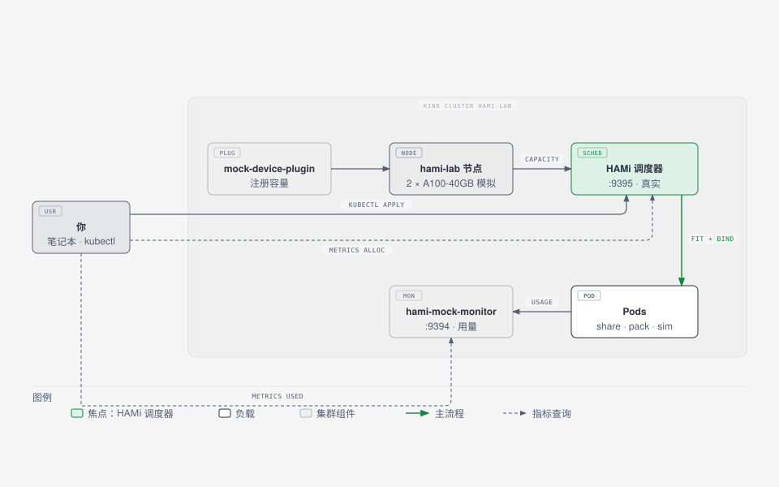
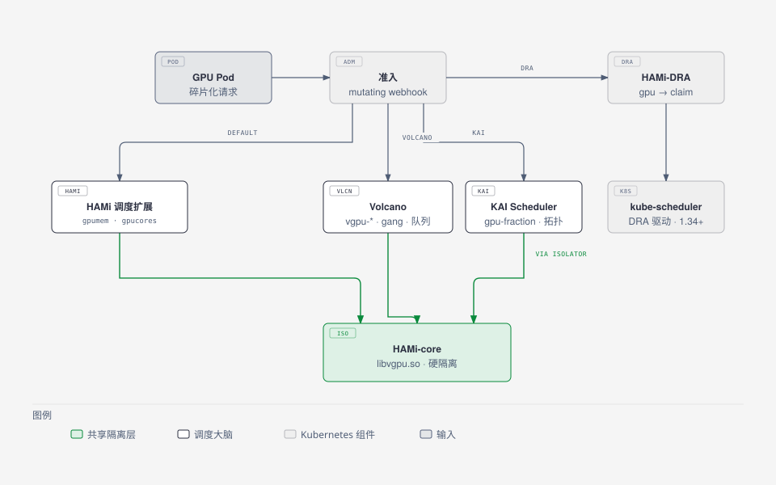
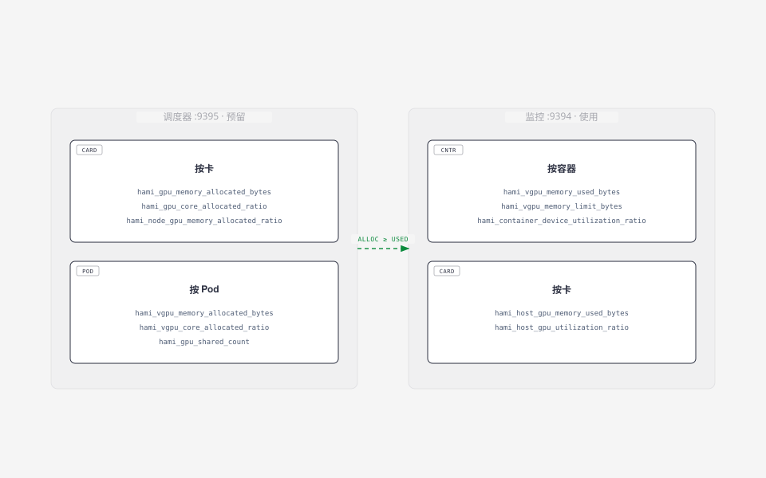

# ContainerDays 2026 新加坡：从零开始共享 GPU

本实验配合 45 分钟工作坊 **From Zero to Shared GPUs: Hands-on GPU Scheduling in Kubernetes with HAMi**，ContainerDays 2026 新加坡场，10 月 27 日 12:30 至 13:15。

HAMi 是 CNCF Incubating 项目，做 Kubernetes 上的异构 GPU 虚拟化，支持 10 余家 GPU/NPU 厂商。45 分钟里，你把一个空的 kind 集群变成可用的 GPU 共享环境，跟踪一次 GPU 请求被拦截、分配、绑定的全过程，再看调度策略与其他调度器如何改变结果，以及 DRA 的位置。

全部在笔记本上运行。调度决策由真实的 HAMi 调度器完成，GPU 是模拟的：

- [mock-device-plugin](https://github.com/Project-HAMi/mock-device-plugin) 根据节点注解注册 `nvidia.com/gpumem` 和 `nvidia.com/gpucores` 容量。
- [hami-mock-monitor](https://github.com/fishman/hami-mock-monitor) 用负载源代替 GPU，输出与 vGPUmonitor 相同的 HAMi 用量指标。

没有 GPU 就没有容器内的显存与算力隔离（这部分由 HAMi-core 负责），讲者会在真实 GPU 上现场演示。



2026-10-20 测试通过：kind 0.33、kubectl 1.37、helm 4.3、HAMi chart 2.10.0、hami-mock-monitor `86adb51`；实验 2、3（含 `spread.yaml`）已于 2026-10-23 复测通过。

## 45 分钟安排

| 时间 | 实验 | 你带走什么 |
| --- | --- | --- |
| 12:30 | 实验 1：安装 HAMi | 一个节点能上报两张模拟 A100 的 vGPU 容量的 kind 集群 |
| 12:40 | 实验 2：共享 GPU | 碎片化请求、完整的拦截链路、一个永远调不上的 Pod |
| 12:50 | 实验 3：调度策略 | 卡维度上的 binpack 与 spread，以及拓扑在哪起作用 |
| 13:00 | 实验 4：默认调度器之外 | KAI Scheduler、Volcano 如何与 HAMi 隔离层组合，DRA 路线 |
| 13:10 | 收尾 | 两组指标，会后可以继续做什么 |

## 准备

- 笔记本，Docker（或 OrbStack / Colima），4 CPU、8 GB 空闲内存
- `kind`、`kubectl`、`helm`、`jq`、`git`
- 若要编译 HAMi 或贡献代码：Go 1.27+（HAMi `go.mod` 为 `go 1.27.2`）
- GitHub 账号

```bash
git clone https://github.com/Project-HAMi/hami-workshop
cd hami-workshop/examples/containerdays-singapore
git clone https://github.com/fishman/hami-mock-monitor
docker pull kindest/node:v1.37.0 busybox:1.36 ghcr.io/llm-d/llm-d-inference-sim:v0.12.0
```

会场 Wi-Fi 慢，镜像请在家里拉好。

## 实验 1：安装 HAMi

```bash
./setup.sh
```

脚本做四件事：

1. 创建 kind 集群 `hami-lab`，给节点打标签 `gpu=on`。
2. 安装 HAMi 2.10.0，关闭真实设备插件，开启 mock 插件。
3. 模拟两张 A100-40GB，需要两个要素：
    - 计数资源 `nvidia.com/gpu=20`（mock 插件的健康门槛，2 卡 x 10 份切分）
    - 节点注解 `hami.io/node-nvidia-register`，内容在 `fake-gpus.json`，真实设备插件读完 NVML 后写的就是它
4. 从源码构建并安装 `completeBinds=true` 的 hami-mock-monitor。

预期结果：

```json
{ "nvidia.com/gpu": "20", "nvidia.com/gpucores": "200",
  "nvidia.com/gpumem": "81920", "nvidia.com/gpumem-percentage": "200" }
```

四处看看：

```bash
kubectl -n kube-system get pods | grep hami
kubectl -n kube-system get cm hami-scheduler-device -o yaml | less
kubectl get node hami-lab-control-plane -o jsonpath='{.metadata.annotations.hami\.io/node-nvidia-register}' | jq
```

**思考题。** 调度器从哪里拿到卡列表？如果把 `health` 改成 `false` 会发生什么？

## 实验 2：共享 GPU

```bash
kubectl apply -f share.yaml -f too-big.yaml
kubectl get pods -o wide
```

`share-1..3` 运行；`too-big` 申请 45000 MB，超过单卡 40960 MB，保持 `Pending`：

```bash
kubectl get events --field-selector involvedObject.name=too-big | tail -2
# 0/1 nodes are available: 1 2/2 CardInsufficientMemory.
```

查看 HAMi 的决定：

```bash
for p in share-1 share-2 share-3; do
  echo -n "$p "; kubectl get pod $p -o jsonpath='{.metadata.annotations.hami\.io/vgpu-devices-allocated}{"\n"}'
done
# share-1 GPU-mock-1,NVIDIA,15000,30:;
# share-2 GPU-mock-0,NVIDIA,15000,30:;
# share-3 GPU-mock-1,NVIDIA,15000,30:;
```

格式为每设备 `uuid,type,memory_mb,cores:`，每容器以 `;` 分隔。设备插件在 `Allocate` 里读它。

### 拦截链路

你刚刚看完了从请求到卡片的完整链路。单节点上分四步：

1. 准入 **webhook** 把 `schedulerName` 改写为 `hami-scheduler`。
2. 调度器 **extender** 在 `Filter` 阶段读节点注解 `hami.io/node-nvidia-register`（实验 1 的卡列表），逐卡检查显存与算力余量，选定一张物理卡的 UUID。
3. `Bind` 阶段把 `hami.io/vgpu-devices-allocated` 写到 Pod 上，设置 `hami.io/bind-phase=allocating` 并拿节点锁 `hami.io/mutex.lock`。
4. 设备插件的 `Allocate` 按 Pod 注解挂载 `/dev/nvidia*` 与 vGPU 文件，写 `success` 并释放锁。mock 插件不做这一步，所以需要 hami-mock-monitor 的 `completeBinds`，没有它下一个 Pod 要等锁最多 5 分钟。

在真实节点上，第 4 步还会通过 `ld.so.preload` 注入 `libvgpu.so`，从那一刻起 HAMi-core 开始强制执行显存与算力上限。

## 实验 3：调度策略

放置发生在两个维度上，HAMi 各提供一个 Pod 注解：

| 维度 | 注解 | binpack | spread |
| --- | --- | --- | --- |
| 选哪个节点 | `hami.io/node-scheduler-policy` | 更少的节点 | 分散到各节点 |
| 节点上选哪张卡 | `hami.io/gpu-scheduler-policy` | 同一张卡 | 分散到各卡 |

两个维度都按利用率比值打分：binpack 偏向更满的卡（整合），spread 偏向更空的卡（分散）。本实验只有一个节点，节点维度只有一个候选；卡维度在两张模拟 A100 上完全可观察：

```bash
kubectl delete -f share.yaml -f too-big.yaml
kubectl apply -f binpack.yaml
for p in pack-1 pack-2; do
  echo -n "$p "; kubectl get pod $p -o jsonpath='{.metadata.annotations.hami\.io/vgpu-devices-allocated}{"\n"}'
done
```

两个 Pod 报告同一个 `GPU-mock-X`：两个负载共享一张卡。再来相反方向：

```bash
kubectl delete -f binpack.yaml
kubectl apply -f spread.yaml
for p in spread-1 spread-2; do
  echo -n "$p "; kubectl get pod $p -o jsonpath='{.metadata.annotations.hami\.io/vgpu-devices-allocated}{"\n"}'
done
```

一卡一 Pod。同样的集群、同样的请求、不同的策略、不同的放置。

**拓扑感知。** 分配注解里写的是精确的卡 UUID，选卡本身就是拓扑决策：在多卡节点上它决定 NVLink 与 PCIe 亲和。`fake-gpus.json` 里每张卡带 `numa` 字段，真实设备插件从驱动读取的也是同类信息。卡维度 spread 让 Pod 各占一卡，binpack 压到一卡上。跨卡、跨节点的显式拓扑感知放置，正是下一个实验里调度器补上的能力。

## 实验 4：默认调度器之外

HAMi 是两样东西：一套容量模型（扩展资源加你刚用过的调度器 extender），以及 HAMi-core 隔离库。别的调度器可以替换放置的大脑，保留隔离层：



**KAI Scheduler** 是 NVIDIA 的 AI 负载调度器（CNCF Sandbox）：gang 调度、层级公平队列、碎片化 GPU 与拓扑感知放置。v0.16.4 起与 HAMi 组合：开启 `global.gpuSharing=true` 和 `binder.plugins.hamicore.enabled=true`，kai-resource-isolator DaemonSet 加一个 mutating webhook 把同一个 `libvgpu.so` 送进 Pod，并根据 `gpu-fraction` 或 `gpu-memory` 注解注入 `CUDA_DEVICE_MEMORY_LIMIT`。放置决策归 KAI，显存上限由 HAMi-core 硬性执行。

**Volcano** 走 vGPU 路线而不是标准 HAMi chart：Volcano 调度器加 `deviceshare` 插件，加 volcano-vgpu-device-plugin，资源名是 `volcano.sh/vgpu-number`、`volcano.sh/vgpu-memory`、`volcano.sh/vgpu-cores`，每个作业写 `schedulerName: volcano`。gang 调度（`minAvailable`）与队列 `capability` 配额和同一套 HAMi-core 隔离组合。一条铁律：每个 GPU 节点只走一条设备插件路线，标准 HAMi 设备插件与 Volcano vGPU 插件绝不同装一节点。

**DRA** 改的是资源模型本身。[HAMi-DRA](https://github.com/Project-HAMi/HAMi-DRA) 是一个 mutating webhook，把 `nvidia.com/gpu` 请求改写为 DRA ResourceClaim，于是同一份 Pod 清单在 Kubernetes 1.34+（开启 DRA Consumable Capacity 特性门控、运行时启用 CDI）上继续可用。还有面向 Kueue 准入的 ResourceClaimTemplate 模式。你的 Pod YAML 不变，下面的机器变了。

这个时段不做现场安装：10 分钟装不完，一个模拟节点也不需要。跟着读一遍，回家试试 [Volcano vGPU 教程](https://project-hami.io/tutorials/labs/volcano-vgpu-gang-queue)。

## 收尾

HAMi 暴露两组指标，分别代表"预留"与"使用"：



```bash
./metrics.sh scheduler
./metrics.sh monitor
```

给 mock 一个真实负载，看固定预留之下的使用量波动：

```bash
kubectl apply -f sim.yaml
watch -n 5 "./metrics.sh monitor | grep 'pod=\"sim\"'"
```

`sim` 是兼容 vLLM 的推理模拟器，运行中的请求数在 0 到 5 之间振荡，利用率在 0 到 33 之间变化（负载 x 分配算力），显存稳定在限制值的 0.9 倍，因为 vLLM 会预分配 KV cache。

**思考题。** 卡 `GPU-mock-1` 显存分配 73%、使用 20%。容量仪表盘该放哪个数，成本报表该放哪个数？

## 会后：在 HAMi WebUI 中直观查看

`metrics.sh` 适合终端操作，而 [HAMi WebUI](https://github.com/Project-HAMi/HAMi-WebUI) 能把同一批数字变成仪表盘。它需要集群里有 Prometheus：

```bash
helm repo add prometheus-community https://prometheus-community.github.io/helm-charts
helm repo add hami-webui https://project-hami.github.io/HAMi-WebUI
helm upgrade --install prometheus prometheus-community/kube-prometheus-stack \
  --version 75.15.1 -n monitoring --create-namespace --set grafana.enabled=false --wait
kubectl apply -f monitoring.yaml   # 采集 :9395 与 :9394
kubectl apply -f webui-rules.yaml  # 把指标名翻译成 WebUI 认识的词表
helm upgrade --install my-hami-webui hami-webui/hami-webui \
  --set externalPrometheus.enabled=true \
  --set externalPrometheus.address="http://prometheus-kube-prometheus-prometheus.monitoring.svc.cluster.local:9090" \
  --set dcgm-exporter.enabled=false \
  --set image.frontend.digest="" --set image.backend.digest="" \
  -n kube-system --wait
kubectl -n kube-system port-forward svc/my-hami-webui 3000:3000
```

打开 <http://localhost:3000> 。集群概览页展示两张模拟 A100、每张卡的显存预留和使用趋势，数据全部来自收尾部分的两组指标：

> **为什么需要 `webui-rules.yaml`？** WebUI 查询的是 vGPUmonitor 的指标名（`hami_memory_size`、`hami_core_util`、`hami_container_vgpu_allocated` 等），而本实验的调度器和 mock monitor 输出的是新的 bytes/ratio 命名（`hami_gpu_memory_limit_bytes`、`hami_host_gpu_utilization_ratio` 等）。这组 PrometheusRule 把后者录制为前者；不装它，所有分配/使用面板都是空的，只剩节点和卡列表（那两部分来自调度器 API 而不是 Prometheus）。


节点页按卡分解：分配进度条来自调度器指标，使用进度条来自 mock monitor。图中卡 0 几乎占满（binpack 策略把两个 Pod 压在同一张卡），卡 1 只跑 `sim`：


`--set image.*.digest=""` 让 chart 改用 `v1.3.0` 标签。给离线会场预拉镜像时这一点很关键：digest 引用在 `kind load` 之后无法保留原名。把下面这些加进"准备"一节的拉取清单：

```bash
docker pull quay.io/prometheus/prometheus:v3.5.0 quay.io/prometheus/alertmanager:v0.28.1 \
  quay.io/prometheus/node-exporter:v1.9.1 quay.io/prometheus-operator/prometheus-operator:v0.83.0 \
  quay.io/prometheus-operator/prometheus-config-reloader:v0.83.0 \
  registry.k8s.io/kube-state-metrics/kube-state-metrics:v2.16.0 \
  projecthami/hami-webui-be-oss:v1.3.0 projecthami/hami-webui-fe-oss:v1.3.0
for i in $(docker images --format '{{.Repository}}:{{.Tag}}' | grep -E 'prometheus|webui|kube-state'); do kind load docker-image $i --name hami-lab; done
```

## 会后：贡献

挑一个，开一个 draft PR。

- **HAMi**：`git clone https://github.com/Project-HAMi/HAMi && cd HAMi && make test`。从 `pkg/device/nvidia/device.go`（`Fit`、`PatchAnnotations`）或 `pkg/scheduler/scheduler.go`（`Filter`、`Bind`）入手。提交需 `git commit -s`，PR 中说明 AI 辅助。
- **HAMi-DRA**：把 `nvidia.com/gpu` 请求转换为 DRA ResourceClaim 的 webhook，需要 Kubernetes 1.34+ 与 DRA consumable capacity。
- **mock-device-plugin**：在 `Allocate` 中完成绑定（`hami-mock-monitor/upstream/mock-device-plugin` 备有补丁），或增加厂商。
- **hami-mock-monitor**：支持更多厂商（昇腾、海光）、实验用 Grafana 面板、发布镜像。

## 清理

```bash
kind delete cluster --name hami-lab
```
