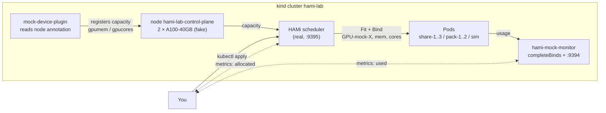
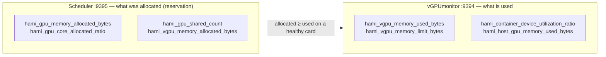

# ContribFest Lab: GPU Sharing Without a GPU

This lab goes with the KubeCon ContribFest session **GPU Virtualization: First Setup and Understanding the Device Plugin / DRA** (75 min). The slides stop at four lab breakpoints, and each one maps to a section below.

Everything runs on a laptop. The real HAMi scheduler makes the decisions. The GPUs are fake:

- [mock-device-plugin](https://github.com/Project-HAMi/mock-device-plugin) turns a node annotation into `nvidia.com/gpumem` and `nvidia.com/gpucores` capacity.
- [hami-mock-monitor](https://github.com/fishman/hami-mock-monitor) produces HAMi's usage metrics (normally from vGPUmonitor and HAMi-core) from a load source instead of a GPU.

What you do **not** get without a GPU: memory and compute isolation inside the container. That part is HAMi-core, and the presenter shows it live on a real card.



Tested on 2026-10-20 with kind 0.33, kubectl 1.37, helm 4.3, HAMi chart 2.10.0 and hami-mock-monitor `86adb51`.

## Before the session

- Docker (or OrbStack / Colima), 4 CPU and 8 GB free
- `kind`, `kubectl`, `helm`, `jq`, `git`
- Go 1.27+ only if you want to build HAMi or contribute code (HAMi `go.mod` is `go 1.27.2`)
- A GitHub account

```bash
git clone https://github.com/fishing-agents/hami-workshop
cd hami-workshop/examples/contribfest
git clone https://github.com/fishman/hami-mock-monitor
docker pull kindest/node:v1.37.0 busybox:1.36 ghcr.io/llm-d/llm-d-inference-sim:v0.12.0
```

Conference Wi-Fi is slow. Pull images at home.

## Lab 1: Install HAMi (breakpoint 1)

```bash
./setup.sh
```

The script:

1. Creates a kind cluster `hami-lab` and labels the node `gpu=on`.
2. Installs HAMi 2.10.0 with the real device plugin off and the mock plugin on.
3. Fakes two A100-40GB cards. Two pieces are needed:
    - the count resource `nvidia.com/gpu=20` (the mock plugin's health gate, 2 cards x 10 splits)
    - the node annotation `hami.io/node-nvidia-register` from `fake-gpus.json`, which is what the real device plugin writes after it reads NVML
4. Builds and installs hami-mock-monitor with `completeBinds=true`.

Expected at the end:

```json
{ "nvidia.com/gpu": "20", "nvidia.com/gpucores": "200",
  "nvidia.com/gpumem": "81920", "nvidia.com/gpumem-percentage": "200" }
```

Look around:

```bash
kubectl -n kube-system get pods | grep hami
kubectl -n kube-system get cm hami-scheduler-device -o yaml | less
kubectl get node hami-lab-control-plane -o jsonpath='{.metadata.annotations.hami\.io/node-nvidia-register}' | jq
```

**Questions.** Where does the scheduler get the card list from? What would change if `health` was `false`?

## Lab 2: Share a GPU (breakpoint 2)

```bash
kubectl apply -f share.yaml -f too-big.yaml
kubectl get pods -o wide
```

`share-1..3` run. `too-big` asks for 45000 MB, more than any 40960 MB card, and stays `Pending`:

```bash
kubectl get events --field-selector involvedObject.name=too-big | tail -2
# 0/1 nodes are available: 1 2/2 CardInsufficientMemory.
```

See what HAMi decided:

```bash
for p in share-1 share-2 share-3; do
  echo -n "$p "; kubectl get pod $p -o jsonpath='{.metadata.annotations.hami\.io/vgpu-devices-allocated}{"\n"}'
done
# share-1 GPU-mock-1,NVIDIA,15000,30:;
# share-2 GPU-mock-0,NVIDIA,15000,30:;
# share-3 GPU-mock-1,NVIDIA,15000,30:;
```

The format is `uuid,type,memory_mb,cores:` per device, `;` per container. The device plugin reads it in `Allocate`.

Try a scheduling policy:

```bash
kubectl delete -f share.yaml -f too-big.yaml
kubectl apply -f binpack.yaml
```

With `hami.io/gpu-scheduler-policy: binpack` both Pods land on the same card. Change it to `spread` and compare.

**Bind phase.** HAMi binds in two steps: the scheduler sets `hami.io/bind-phase=allocating` and takes the node lock `hami.io/mutex.lock`, and the device plugin sets `success` and releases it. The mock plugin skips the second step, so `completeBinds` in hami-mock-monitor does it. Without it the next Pod waits up to 5 minutes for the lock.

## Lab 3: Observe (breakpoint 3)

HAMi exposes two metric sets. Keep them apart: one is a reservation, the other is usage.



**Scheduler, port 9395: what was allocated**

- `hami_gpu_memory_limit_bytes`, `hami_gpu_core_limit_ratio`: card capacity
- `hami_gpu_memory_allocated_bytes`, `hami_gpu_core_allocated_ratio`: reserved on the card
- `hami_node_gpu_memory_allocated_ratio`: reserved / capacity, 0 to 1
- `hami_gpu_shared_count`: containers sharing the card
- `hami_vgpu_memory_allocated_bytes`, `hami_vgpu_core_allocated_ratio`: per Pod
- `hami_resource_quota_used`: per namespace

**vGPUmonitor, port 9394: what is used** (here served by hami-mock-monitor, same names and labels)

- `hami_vgpu_memory_used_bytes`, `hami_vgpu_memory_limit_bytes`: per container and device
- `hami_container_device_utilization_ratio`: SM utilization, percent of the whole device
- `hami_host_gpu_utilization_ratio`, `hami_host_gpu_memory_used_bytes`: per card, summed over its containers

On a real node vGPUmonitor also reports ECC errors and `hami_container_last_kernel_elapsed_seconds` (idle detection). The mock fakes temperature and power (you will see `hami_host_gpu_temperature_celsius` and `hami_host_gpu_power_usage_watts`), but not those.

```bash
./metrics.sh scheduler
./metrics.sh monitor
```

Now give the mock a realistic load. `sim.yaml` runs [llm-d-inference-sim](https://github.com/llm-d/llm-d-inference-sim), a vLLM-compatible server whose running requests oscillate 0 to 5 over 2 minutes:

```bash
kubectl apply -f sim.yaml
watch -n 5 "./metrics.sh monitor | grep 'pod=\"sim\"'"
```

`hami_container_device_utilization_ratio` moves between 0 and 33 because utilization = load x allocated cores (33). Memory stays at 0.9 x the limit because vLLM preallocates its KV cache.

**Questions.** Card `GPU-mock-1` shows 73% memory allocated but 20% used. Which number goes on a capacity dashboard, and which on a cost report? What happens to the usage series when the sim stops answering?

## Optional: see it in the HAMi WebUI

`metrics.sh` is fine for a terminal, but the [HAMi WebUI](https://github.com/Project-HAMi/HAMi-WebUI) turns the same numbers into dashboards. It needs a Prometheus in the cluster:

```bash
helm repo add prometheus-community https://prometheus-community.github.io/helm-charts
helm repo add hami-webui https://project-hami.github.io/HAMi-WebUI
helm upgrade --install prometheus prometheus-community/kube-prometheus-stack \
  --version 75.15.1 -n monitoring --create-namespace --set grafana.enabled=false --wait
kubectl apply -f monitoring.yaml   # scrape :9395 and :9394
kubectl apply -f webui-rules.yaml  # translate metric names for the WebUI
helm upgrade --install my-hami-webui hami-webui/hami-webui \
  --set externalPrometheus.enabled=true \
  --set externalPrometheus.address="http://prometheus-kube-prometheus-prometheus.monitoring.svc.cluster.local:9090" \
  --set dcgm-exporter.enabled=false \
  --set image.frontend.digest="" --set image.backend.digest="" \
  -n kube-system --wait
kubectl -n kube-system port-forward svc/my-hami-webui 3000:3000
```

Open <http://localhost:3000> . The overview page shows the two fake A100 cards, the reserved memory per card and the usage trend, all fed by the two metric sets from Lab 3:

> **Why `webui-rules.yaml`?** The WebUI queries vGPUmonitor's metric names (`hami_memory_size`, `hami_core_util`, `hami_container_vgpu_allocated`, ...). This lab's scheduler and mock monitor expose the newer byte/ratio names (`hami_gpu_memory_limit_bytes`, `hami_host_gpu_utilization_ratio`, ...). The PrometheusRule records one set as the other, so without it every allocation and usage panel stays empty and only the node and card lists (which come from the scheduler API, not Prometheus) render.


The Nodes page breaks it down per card: allocation meters come from the scheduler metrics, usage meters from the mock monitor. Here card 0 is nearly full (two Pods binpacked on it) while card 1 only runs `sim`:


`--set image.*.digest=""` makes the chart use the `v1.3.0` tags, which matters when you pre-pull images for an offline room: digest references cannot be re-tagged after `kind load`. Add these to the pull list from "Before the session":

```bash
docker pull quay.io/prometheus/prometheus:v3.5.0 quay.io/prometheus/alertmanager:v0.28.1 \
  quay.io/prometheus/node-exporter:v1.9.1 quay.io/prometheus-operator/prometheus-operator:v0.83.0 \
  quay.io/prometheus-operator/prometheus-config-reloader:v0.83.0 \
  registry.k8s.io/kube-state-metrics/kube-state-metrics:v2.16.0 \
  projecthami/hami-webui-be-oss:v1.3.0 projecthami/hami-webui-fe-oss:v1.3.0
for i in $(docker images --format '{{.Repository}}:{{.Tag}}' | grep -E 'prometheus|webui|kube-state'); do kind load docker-image $i --name hami-lab; done
```

## Lab 4: Contribute (breakpoint 4)

Pick one, pair with a maintainer, open a draft PR.

- **HAMi**: `git clone https://github.com/Project-HAMi/HAMi && cd HAMi && make test`. Start in `pkg/device/nvidia/device.go` (`Fit`, `PatchAnnotations`) or `pkg/scheduler/scheduler.go` (`Filter`, `Bind`). Commits need `git commit -s`. Disclose AI help in the PR.
- **mock-device-plugin**: complete the bind in `Allocate` (a patch is prepared in `hami-mock-monitor/upstream/mock-device-plugin`), or add a vendor.
- **hami-mock-monitor**: other vendors (Ascend, Hygon), a Grafana dashboard for the lab, a published image.
- **HAMi-DRA**: the webhook that turns `nvidia.com/gpu` requests into DRA ResourceClaims. Needs Kubernetes 1.34+ with DRA consumable capacity.
- **This lab**: fix what broke for you, add the Chinese page.

## Clean up

```bash
kind delete cluster --name hami-lab
```
