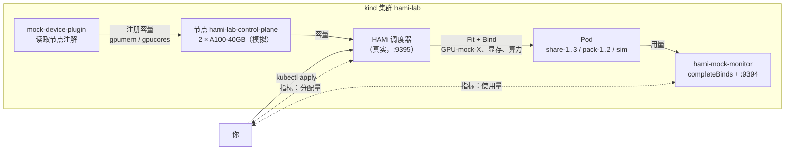
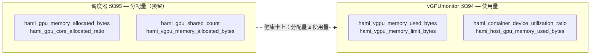
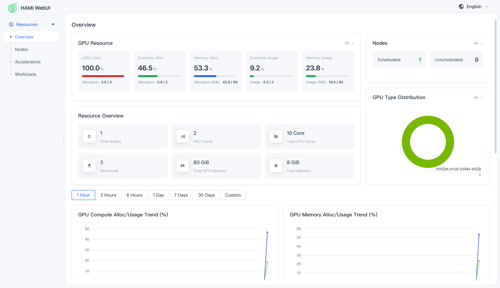
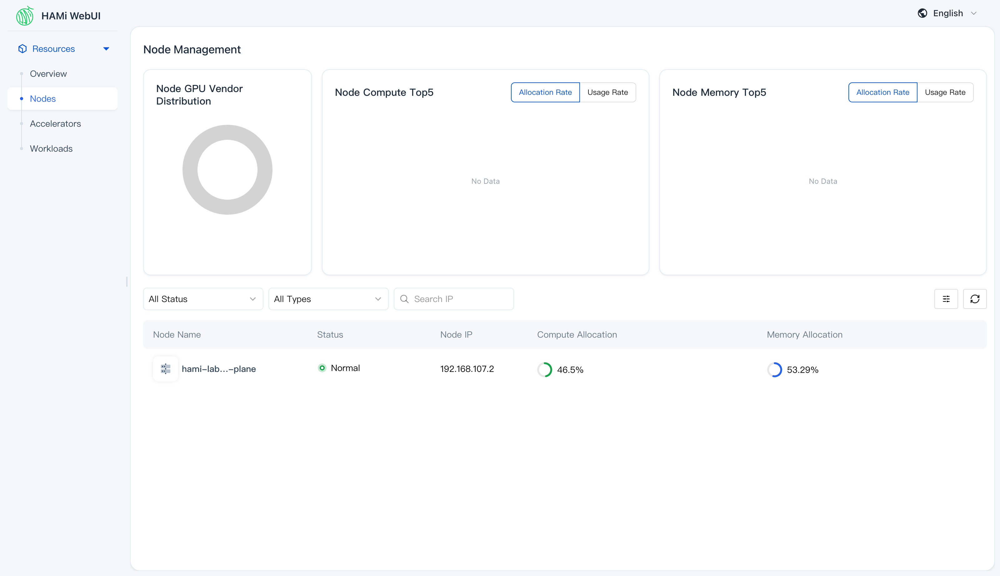

# ContribFest 实验：没有 GPU 也能共享 GPU

本实验配合 KubeCon ContribFest 议题 **GPU Virtualization: First Setup and Understanding the Device Plugin / DRA**（75 分钟）。幻灯片有四个实验断点，对应下面四节。

全部在笔记本上运行。调度决策由真实的 HAMi 调度器完成，GPU 是模拟的：

- [mock-device-plugin](https://github.com/Project-HAMi/mock-device-plugin) 根据节点注解注册 `nvidia.com/gpumem` 和 `nvidia.com/gpucores`。
- [hami-mock-monitor](https://github.com/fishman/hami-mock-monitor) 用负载源代替 GPU，输出与 vGPUmonitor 相同的 HAMi 用量指标。

没有 GPU 就没有容器内的显存与算力隔离（这部分由 HAMi-core 负责），讲者会在真实 GPU 上现场演示。



2026-10-20 测试通过：kind 0.33、kubectl 1.37、helm 4.3、HAMi chart 2.10.0、hami-mock-monitor `86adb51`。

## 准备

- Docker（或 OrbStack / Colima），4 CPU、8 GB 空闲内存
- `kind`、`kubectl`、`helm`、`jq`、`git`
- 若要编译 HAMi 或贡献代码：Go 1.27+
- GitHub 账号

```bash
git clone https://github.com/fishing-agents/hami-workshop
cd hami-workshop/examples/contribfest
git clone https://github.com/fishman/hami-mock-monitor
docker pull kindest/node:v1.37.0 busybox:1.36 ghcr.io/llm-d/llm-d-inference-sim:v0.12.0
```

## 实验 1：安装 HAMi（断点 1）

```bash
./setup.sh
```

脚本创建 kind 集群 `hami-lab`，安装关闭真实设备插件、开启 mock 插件的 HAMi 2.10.0，用计数资源 `nvidia.com/gpu=20` 和节点注解 `hami.io/node-nvidia-register`（见 `fake-gpus.json`）模拟两张 A100-40GB，最后安装 `completeBinds=true` 的 hami-mock-monitor。

预期：`nvidia.com/gpu=20`、`nvidia.com/gpumem=81920`、`nvidia.com/gpucores=200`。

## 实验 2：共享 GPU（断点 2）

```bash
kubectl apply -f share.yaml -f too-big.yaml
kubectl get pods -o wide
kubectl get events --field-selector involvedObject.name=too-big | tail -2
```

`share-1..3` 运行；`too-big` 申请 45000 MB，超过单卡 40960 MB，保持 `Pending`（`CardInsufficientMemory`）。

查看分配结果：注解 `hami.io/vgpu-devices-allocated`，格式为每设备 `uuid,type,memory_mb,cores:`，每容器以 `;` 分隔。

调度策略：`kubectl apply -f binpack.yaml`，两个 Pod 落在同一张卡上；改为 `spread` 后分散到两张卡。

绑定分两步：调度器写入 `hami.io/bind-phase=allocating` 并加节点锁 `hami.io/mutex.lock`，设备插件写入 `success` 并释放锁。mock 插件不做第二步，由 hami-mock-monitor 的 `completeBinds` 完成。

## 实验 3：可观测性（断点 3）

两组指标，分别代表"预留"与"使用"：



- **调度器（9395 端口）分配量**：`hami_gpu_memory_allocated_bytes`、`hami_gpu_core_allocated_ratio`、`hami_node_gpu_memory_allocated_ratio`、`hami_gpu_shared_count`、`hami_vgpu_memory_allocated_bytes`、`hami_resource_quota_used`
- **vGPUmonitor（9394 端口）使用量**（此处由 hami-mock-monitor 提供）：`hami_vgpu_memory_used_bytes`、`hami_vgpu_memory_limit_bytes`、`hami_container_device_utilization_ratio`、`hami_host_gpu_utilization_ratio`、`hami_host_gpu_memory_used_bytes`

```bash
./metrics.sh scheduler
./metrics.sh monitor
kubectl apply -f sim.yaml
watch -n 5 "./metrics.sh monitor | grep 'pod=\"sim\"'"
```

`sim` 是兼容 vLLM 的推理模拟器，运行中的请求数在 0 到 5 之间振荡，利用率 = 负载 x 分配算力（33），在 0 到 33 之间变化。

## 可选：在 HAMi WebUI 中直观查看

`metrics.sh` 适合终端操作，而 [HAMi WebUI](https://github.com/Project-HAMi/HAMi-WebUI) 能把同一批数字变成仪表盘。它需要集群里有 Prometheus：

```bash
helm repo add prometheus-community https://prometheus-community.github.io/helm-charts
helm repo add hami-webui https://project-hami.github.io/HAMi-WebUI
helm upgrade --install prometheus prometheus-community/kube-prometheus-stack \
  --version 75.15.1 -n monitoring --create-namespace --set grafana.enabled=false --wait
kubectl apply -f monitoring.yaml   # 采集 :9395 与 :9394
kubectl apply -f webui-rules.yaml  # 把指标名翻译成 WebUI 认识的词表
helm upgrade --install my-hami-webui hami-webui/hami-webui \
  --set externalPrometheus.enabled=true \
  --set externalPrometheus.address="http://prometheus-kube-prometheus-prometheus.monitoring.svc.cluster.local:9090" \
  --set dcgm-exporter.enabled=false \
  --set image.frontend.digest="" --set image.backend.digest="" \
  -n kube-system --wait
kubectl -n kube-system port-forward svc/my-hami-webui 3000:3000
```

打开 <http://localhost:3000> 。集群概览页展示两张模拟 A100、每张卡的显存预留和使用趋势，数据全部来自实验 3 的两组指标：

> **为什么需要 `webui-rules.yaml`？** WebUI 查询的是 vGPUmonitor 的指标名（`hami_memory_size`、`hami_core_util`、`hami_container_vgpu_allocated` 等），而本实验的调度器和 mock monitor 输出的是新的 bytes/ratio 命名（`hami_gpu_memory_limit_bytes`、`hami_host_gpu_utilization_ratio` 等）。这组 PrometheusRule 把后者录制为前者；不装它，所有分配/使用面板都是空的，只剩节点和卡列表（那两部分来自调度器 API 而不是 Prometheus）。



节点页按卡分解：分配进度条来自调度器指标，使用进度条来自 mock monitor。图中卡 0 几乎占满（binpack 策略把两个 Pod 压在同一张卡），卡 1 只跑 `sim`：



`--set image.*.digest=""` 让 chart 改用 `v1.3.0` 标签。给离线会场预拉镜像时这一点很关键：digest 引用在 `kind load` 之后无法保留原名。把下面这些加进"准备"一节的拉取清单：

```bash
docker pull quay.io/prometheus/prometheus:v3.5.0 quay.io/prometheus/alertmanager:v0.28.1 \
  quay.io/prometheus/node-exporter:v1.9.1 quay.io/prometheus-operator/prometheus-operator:v0.83.0 \
  quay.io/prometheus-operator/prometheus-config-reloader:v0.83.0 \
  registry.k8s.io/kube-state-metrics/kube-state-metrics:v2.16.0 \
  projecthami/hami-webui-be-oss:v1.3.0 projecthami/hami-webui-fe-oss:v1.3.0
for i in $(docker images --format '{{.Repository}}:{{.Tag}}' | grep -E 'prometheus|webui|kube-state'); do kind load docker-image $i --name hami-lab; done
```

## 实验 4：贡献（断点 4）

- **HAMi**：`make test`，从 `pkg/device/nvidia/device.go`（`Fit`）或 `pkg/scheduler/scheduler.go`（`Filter`、`Bind`）入手，提交需 `git commit -s`。
- **mock-device-plugin**：在 `Allocate` 中完成绑定，或增加厂商。
- **hami-mock-monitor**：支持更多厂商、实验用 Grafana 面板、发布镜像。
- **HAMi-DRA**：把 `nvidia.com/gpu` 请求转换为 DRA ResourceClaim 的 webhook。
- **本实验**：修复你遇到的问题。

## 清理

```bash
kind delete cluster --name hami-lab
```
