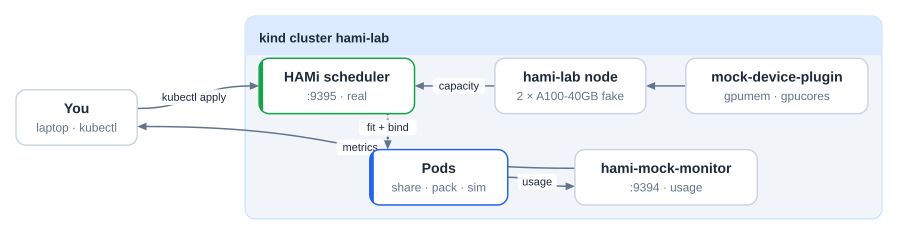
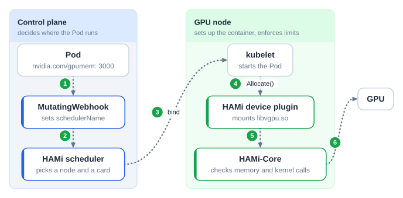
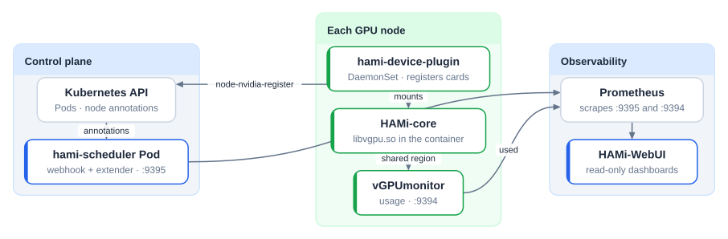
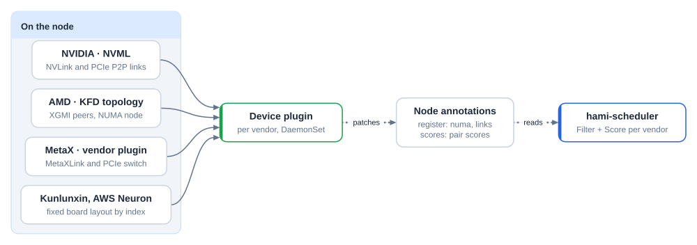
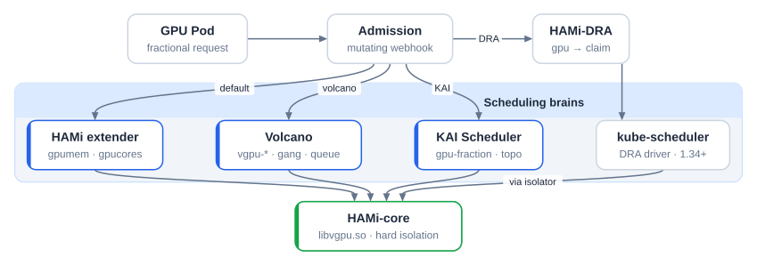
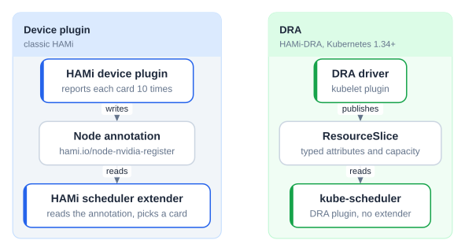
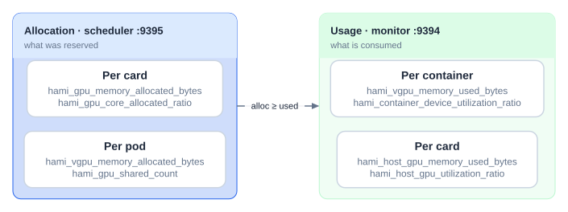
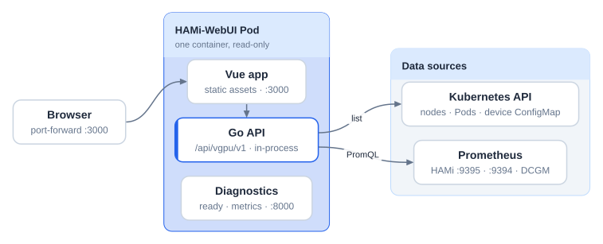

# HAMi lab: GPU sharing without a GPU

A self-paced lab for GPU sharing in Kubernetes with HAMi. It runs on any laptop: the HAMi scheduler is real, the GPUs are fake. In about 80 minutes you install HAMi on kind, share fake A100 cards between Pods, compare scheduling policies, see where topology, other schedulers and DRA fit in, and read the two metric sets HAMi exposes.

- [mock-device-plugin](https://github.com/Project-HAMi/mock-device-plugin) turns a node annotation into `nvidia.com/gpumem` and `nvidia.com/gpucores` capacity.
- [hami-mock-monitor](https://github.com/fishman/hami-mock-monitor) produces HAMi's usage metrics (normally from vGPUmonitor and HAMi-core) from a load source instead of a GPU.

What you do **not** get without a GPU: memory and compute isolation inside the container. That part is HAMi-core. To try it on real hardware, see the footnote on AMD laptops[^amd].



Tested on 2026-11-09 with kind 0.33, kubectl 1.37, helm 4.3, HAMi chart 2.11.0 and hami-mock-monitor 0.2.0.

## Before you start

- Docker in a Linux VM (Docker Desktop, OrbStack or Colima on macOS), 4 CPU and 8 GB free. macOS native containers do not work with kind, see [Install the lab tools](install-tools.md#macos-native-containers-do-not-work).
- `kind`, `kubectl`, `helm`, `jq`, `git`, see [Install the lab tools](install-tools.md).
- Go 1.27+ only if you want to build HAMi or contribute code.

Pull the images **once, before the session**, not at the venue:

```bash
git clone https://github.com/Project-HAMi/hami-workshop
cd hami-workshop/examples/hami-lab
docker pull kindest/node:v1.37.0
docker pull docker.io/projecthami/hami:v2.11.0
docker pull docker.io/projecthami/mock-device-plugin:latest
docker pull docker.io/liangjw/kube-webhook-certgen:v1.1.1
docker pull busybox:1.36
docker pull ghcr.io/llm-d/llm-d-inference-sim:v0.12.0
docker pull ghcr.io/fishman/hami-mock-monitor:0.2.0
```

`setup.sh` loads what you already have into kind and only pulls what is missing.

## How HAMi fits together

A Pod asks for a slice of a card. The webhook routes it to the HAMi scheduler, which picks a node and a card. The device plugin sets up the container and HAMi-core enforces the limits:





## Lab 1: Install HAMi

```bash
./setup.sh
```

The script:

1. Creates a kind cluster `hami-lab` and labels the node `gpu=on`.
2. Loads the pre-pulled images into the cluster.
3. Installs HAMi 2.11.0 with the real device plugin off and the mock plugin on.
4. Fakes two A100-40GB cards: the count resource `nvidia.com/gpu=20` (2 cards x 10 splits) and the node annotation `hami.io/node-nvidia-register` from `fake-gpus.json`, which is what the real device plugin writes after it reads NVML.
5. Installs hami-mock-monitor with `completeBinds=true`.

Expected at the end:

```json
{ "nvidia.com/gpu": "20", "nvidia.com/gpucores": "200",
  "nvidia.com/gpumem": "81920", "nvidia.com/gpumem-percentage": "200" }
```

Look around:

```bash
kubectl -n kube-system get pods | grep hami
kubectl -n kube-system get cm hami-scheduler-device -o yaml | less
kubectl get node hami-lab-control-plane -o jsonpath='{.metadata.annotations.hami\.io/node-nvidia-register}' | jq
```

**Questions.** Where does the scheduler get the card list from? What would change if `health` was `false`?

## Lab 2: Share a GPU

```bash
kubectl apply -f share.yaml -f too-big.yaml
kubectl wait --for=condition=Ready pod/share-1 pod/share-2 pod/share-3 --timeout=120s
kubectl get events --field-selector involvedObject.name=too-big | tail -2
# 0/1 nodes are available: 1 2/2 CardInsufficientMemory.
for p in share-1 share-2 share-3; do
  echo -n "$p "; kubectl get pod $p -o jsonpath='{.metadata.annotations.hami\.io/vgpu-devices-allocated}{"\n"}'
done
# share-1 GPU-mock-1,NVIDIA,15000,30:;
# share-2 GPU-mock-0,NVIDIA,15000,30:;
# share-3 GPU-mock-1,NVIDIA,15000,30:;
```

`too-big` asks for 45000 MB, more than any 40960 MB card, and stays `Pending`. The allocation format is `uuid,type,memory_mb,cores:` per device, `;` per container.

The chain you just watched:

1. The admission **webhook** rewrites `schedulerName` to `hami-scheduler`.
2. The scheduler **extender** at `Filter` reads `hami.io/node-nvidia-register`, checks memory and core headroom per card, and picks a card UUID.
3. At `Bind` it writes `hami.io/vgpu-devices-allocated` onto the Pod, sets `hami.io/bind-phase=allocating` and takes the node lock `hami.io/mutex.lock`.
4. The device plugin's `Allocate` mounts the device and `libvgpu.so`, marks `success` and releases the lock. The mock plugin skips this, which is why hami-mock-monitor has `completeBinds`. Without it the next Pod waits up to 5 minutes for the lock.

## Lab 3: Scheduler policies

| Axis | Annotation | binpack | spread |
| --- | --- | --- | --- |
| Which node | `hami.io/node-scheduler-policy` | fewer nodes | across nodes |
| Which card on that node | `hami.io/gpu-scheduler-policy` | same card | across cards |

```bash
kubectl delete -f share.yaml -f too-big.yaml
kubectl apply -f binpack.yaml
kubectl wait --for=condition=Ready pod/pack-1 pod/pack-2 --timeout=120s
for p in pack-1 pack-2; do
  echo -n "$p "; kubectl get pod $p -o jsonpath='{.metadata.annotations.hami\.io/vgpu-devices-allocated}{"\n"}'
done
kubectl delete -f binpack.yaml
kubectl apply -f spread.yaml
kubectl wait --for=condition=Ready pod/spread-1 pod/spread-2 --timeout=120s
for p in spread-1 spread-2; do
  echo -n "$p "; kubectl get pod $p -o jsonpath='{.metadata.annotations.hami\.io/vgpu-devices-allocated}{"\n"}'
done
```

binpack puts both Pods on the same card, spread puts one on each.

### Mutex: start on an idle card

`hami.io/gpu-scheduler-policy: mutex` (new in HAMi v2.10.0) is a filter: only cards with no tenants are candidates. One small workload on a card is enough to rule it out. Keep the spread Pods running, one on each card:

```bash
kubectl apply -f mutex.yaml
kubectl get events --field-selector involvedObject.name=mutex-1 | tail -1
# 0/1 nodes are available: 1 2/2 ExclusiveDeviceAllocateConflict.
kubectl delete pod spread-2
kubectl wait --for=condition=Ready pod/mutex-1 --timeout=120s
kubectl get pod mutex-1 -o jsonpath='{.metadata.annotations.hami\.io/vgpu-devices-allocated}{"\n"}'
# GPU-mock-0,NVIDIA,15000,30:;
kubectl delete -f spread.yaml -f mutex.yaml --ignore-not-found
```

Both cards have room for `mutex-1`'s memory, but neither is empty, so it waits until one is.

- Mutex is checked **at placement only**. A later Pod without `mutex` can still join the card. To keep a card for the Pod's lifetime, request all of its memory and cores, or pin it with `nvidia.com/use-gpuuuid`.
- Since v2.10.0 policies chain: filters first (`mutex`, `topology-aware`), then sort keys in the order written (`binpack`, `spread`, `numa`). `mutex,binpack,numa` takes an idle card, the best packed of those, with NUMA as the tiebreaker.
- `mutex,topology-aware` on NVIDIA: idle cards first, then the best NVLink-connected set among them. If a card in the best set is busy, the Pod gets a worse set or stays Pending.

### Where topology information comes from

The scheduler never reads the hardware. Each vendor's device plugin reads it on the node and writes node annotations, and the scheduler scores cards from them:



- **NVIDIA:** with `ENABLE_TOPOLOGY_SCORE=true` the plugin scores every card pair from NVML (NVLink, PCIe) into `hami.io/node-nvidia-score`. With policy `topology-aware`, one card gets the least connected card and N cards get the best connected set.
- **AMD:** `xgmiPeers` and `numa` per GPU in `hami.io/node-amd-register`. Pods can ask for `amd.com/numa-bind`, `amd.com/link-bind` or `topology-aware`.
- **MetaX:** the vendor plugin writes `metax-tech.com/gpu.topology.scores` and `.losses`. MetaXLink first, then PCIe switch.
- **Kunlunxin, AWS Neuron:** no link data. The layout is fixed, so the scheduler derives it from the card index.

### CPU and GPU on the same NUMA node (read-along)

The scheduler picks the GPU, kubelet's Topology Manager picks the CPUs. Since HAMi v2.11.0 the device plugin asks the scheduler to refit when the two disagree, so CPUs, the GPU and HAMi's accounting end up on the same NUMA node. kind has a single NUMA node, so this is read-along.

```yaml
# kubelet config
cpuManagerPolicy: static
topologyManagerPolicy: single-numa-node
topologyManagerScope: container
```

```yaml
metadata:
  annotations:
    hami.io/numa-alignment: best-effort   # or strict
```

- Helm: `devices.nvidia.enableNumaTopology`, `devicePlugin.numaRefit.enabled`, and per node `enablegetpreferredallocation`. All off by default.
- `best-effort`: if the refit fails, kubelet's choice stands and is logged. `strict`: the allocation fails.
- Only Guaranteed QoS Pods with integer CPUs, in hami-core mode. See the [NUMA alignment guide](https://project-hami.io/docs/userguide/nvidia-device/numa-alignment).

## Lab 4: Flexible MIG (read-along)

MIG needs an Ampere or newer GPU, and the mock cards cannot create GPU instances.

- **Static MIG:** NVIDIA MIG Manager. A whole-GPU layout chosen up front, and changing it means draining. Pods ask for `nvidia.com/mig-1g.10gb`.
- **Dynamic MIG, HAMi v2.5.0:** `knownMigGeometries` lists whole-card templates per model. The scheduler takes the first template that fits and the device plugin applies it with mig-parted. A new profile mix means switching the template, so the card has to be empty first.
- **Flexible MIG, HAMi v2.10.0:** no templates. Profiles and legal placements come from NVML, the scheduler reserves the smallest allowed profile that fits the `gpumem` request in `hami.io/vgpu-mig-allocations`, and the device plugin creates the instance at `Allocate` and removes it when the Pod ends. No drain.
- **v2.11.0:** a CDI spec per MIG instance (v2.10.0 MIG did not work with CDI device injection), placement scoring with backtracking, `nvidia.com/mig-profile-preference`, and Cluster Autoscaler support through `devicePlugin.reportNodeCapacity`.

```yaml
# node config: "operatingmode": "mig"
nvidia:
  migProfileAllowlist:
    - models: ["A100-SXM4-40GB"]
      profiles: ["1g.5gb", "2g.10gb", "3g.20gb", "7g.40gb"]
```

```yaml
metadata:
  annotations:
    nvidia.com/vgpu-mode: "mig"
# limits: nvidia.com/gpu: 1, nvidia.com/gpumem: 8000  -> 2g.10gb
```

The Pod spec is the same as in Lab 2. Free slices without a legal contiguous placement leave the Pod Pending, and HAMi never moves a running instance. HAMi and NVIDIA MIG Manager must not manage the same GPU. See [Dynamic MIG support](https://project-hami.io/docs/userguide/nvidia-device/dynamic-mig-support).

## Lab 5: Beyond the default scheduler

HAMi is a capacity model plus HAMi-core, the isolation library. Other schedulers can replace the placement and keep the isolation:



- **KAI Scheduler** (v0.16.4+): `global.gpuSharing=true` and `binder.plugins.hamicore.enabled=true`. KAI places, HAMi-core caps memory from `gpu-fraction` or `gpu-memory`.
- **Volcano**: the `deviceshare` plugin plus the volcano-vgpu-device-plugin, resources `volcano.sh/vgpu-*`. Gang scheduling and queue caps on shared GPUs. Run only one device plugin path per GPU node. Try the [Volcano vGPU tutorial](https://project-hami.io/tutorials/labs/volcano-vgpu-gang-queue).

### Install the Volcano vGPU plugin

From the [volcano-vgpu-device-plugin README](https://github.com/Project-HAMi/volcano-vgpu-device-plugin). Plugin v1.13.0 needs Volcano v1.15.0 or later. In `volcano-scheduler-configmap` (namespace `volcano-system`) enable vGPU:

```yaml
- name: deviceshare
  arguments:
    deviceshare.VGPUEnable: true
    deviceshare.SchedulePolicy: binpack  # or spread
```

No Helm repository is published yet, so install from a checkout. `nvmlMock.enabled=true` runs it without GPUs, which is enough to check scheduling and registration:

```bash
git clone https://github.com/Project-HAMi/volcano-vgpu-device-plugin
cd volcano-vgpu-device-plugin
helm install volcano-vgpu-device-plugin deployments/helm/volcano-vgpu-device-plugin \
  --set nvmlMock.enabled=true
kubectl get node <node> -o jsonpath='{.status.allocatable}'
```

`volcano.sh/vgpu-number` and `volcano.sh/vgpu-memory` should be listed. Do not install it on a node that runs the HAMi device plugin.

### DRA



DRA has four objects: a **ResourceSlice** (published by the driver, devices with attributes and capacity), a **DeviceClass** (devices selected with CEL, HAMi uses `hami-core-gpu.project-hami.io`), a **ResourceClaim** (a Pod's request) and a **ResourceClaimTemplate** (one claim per Pod). With consumable capacity (`DRAConsumableCapacity`, on by default since 1.36) one card serves many claims:

```yaml
apiVersion: resource.k8s.io/v1
kind: ResourceClaim
metadata: { name: single-gpu-0 }
spec:
  devices:
    requests:
    - name: single-gpu
      exactly:
        deviceClassName: hami-core-gpu.project-hami.io
        capacity:
          requests: { cores: 30, memory: "4Gi" }
```

[HAMi-DRA](https://github.com/Project-HAMi/HAMi-DRA) keeps the HAMi Pod spec: a webhook rewrites `nvidia.com/gpu` requests into claims.


It needs Kubernetes 1.34+ and CDI in containerd or CRI-O, so it is a read-along in this lab.

## New in v2.11.0 (read-along)

### Remote GPU

CUDA on a node with no GPU and no driver, served over the network by [Lupine](https://github.com/lupinemachines). GPU nodes with `operatingmode: remote` serve Lupine instead of advertising local devices. On the client, an init container delivers the Lupine client libraries and `nvidia-smi`, and HAMi injects `LUPINE_SERVER`.

```yaml
# vLLM on a GPU-less node
resources:
  limits:
    nvidia.com/remote-gpu: 2               # reserves a whole server
    nvidia.com/remote-gpu-memory: 20480    # per GPU, enforced by HAMi-core
```

Enable with `devices.remotegpu.enabled`. Servers can be pooled by Node label and picked with `hami.io/remote-server`. Client and server nodes must be separate, and supported images are CUDA and vLLM 0.19 to 0.26. Examples: [HAMi examples/remotegpu](https://github.com/Project-HAMi/HAMi/tree/master/examples/remotegpu).

### AMD Instinct sharing

The NVIDIA resource model with hard limits in the container, enforced by amd-hami-core:

- **Memory:** `amd.com/gpumem` or `amd.com/gpumem-percentage`.
- **Compute:** `amd.com/gpucores` sets the compute unit share through `HSA_CU_MASK`.
- **Placement:** `amd.com/numa-bind`, XGMI-linked cards with `amd.com/link-bind`, and the `binpack`, `spread`, `mutex` and `topology-aware` policies.
- **Node side:** amd-device-plugin v0.0.4 adds SPX, DPX, QPX and CPX compute partitions. amd-dra-driver brings the same limits to DRA.

See the [AMD GPU guide](https://project-hami.io/docs/next/userguide/amd-device/enable-amd-gpu-sharing).

## Wrap-up: reserved is not used



```bash
./metrics.sh scheduler
./metrics.sh monitor
kubectl apply -f sim.yaml
watch -n 5 "./metrics.sh monitor | grep 'pod=\"sim\"'"
```

`sim` is a vLLM-compatible simulator. Its utilization moves between 0 and 33 while memory stays at 0.9 x the limit, because vLLM preallocates its KV cache.

**Question.** A card shows 73% memory allocated but 20% used. Which number goes on a capacity dashboard, and which on a cost report?

## Optional: HAMi WebUI



```bash
docker pull projecthami/hami-webui-be-oss:v1.3.0 projecthami/hami-webui-fe-oss:v1.3.0   # once, at home
helm repo add prometheus-community https://prometheus-community.github.io/helm-charts
helm repo add hami-webui https://project-hami.github.io/HAMi-WebUI
helm upgrade --install prometheus prometheus-community/kube-prometheus-stack \
  --version 75.15.1 -n monitoring --create-namespace --set grafana.enabled=false --wait
kubectl apply -f monitoring.yaml -f webui-rules.yaml
helm upgrade --install my-hami-webui hami-webui/hami-webui \
  --set externalPrometheus.enabled=true \
  --set externalPrometheus.address="http://prometheus-kube-prometheus-prometheus.monitoring.svc.cluster.local:9090" \
  --set dcgm-exporter.enabled=false \
  --set image.frontend.digest="" --set image.backend.digest="" \
  -n kube-system --wait
kubectl -n kube-system port-forward svc/my-hami-webui 3000:3000
```

`webui-rules.yaml` records the scheduler's and mock monitor's newer metric names under the names the WebUI queries. Without it the allocation and usage panels stay empty.

To hack on the WebUI:

```bash
git clone https://github.com/Project-HAMi/HAMi-WebUI && cd HAMi-WebUI
make bootstrap && make -C server bootstrap
make -C server run   # Go API on :8000, point server/config/config.yaml at Prometheus
make dev             # Vite on :3000
make verify && make -C server verify
```

## Contribute

- **HAMi**: `make test`. Start in `pkg/device/nvidia/device.go` (`Fit`) or `pkg/scheduler/scheduler.go` (`Filter`, `Bind`).
- **HAMi-DRA**: the webhook that turns `nvidia.com/gpu` requests into DRA claims.
- **mock-device-plugin**: complete the bind in `Allocate`, or add a vendor.
- **hami-mock-monitor**: other vendors, a Grafana dashboard for the lab.

Commits need `git commit -s`. Look for `good first issue` and open a draft PR.

## Troubleshooting

### macOS: give the VM enough room

kind runs every node as a container inside the Docker VM, so the VM needs 4 CPU and 8 GB.

- **Docker Desktop:** Settings, Resources, Advanced: CPU limit 4, memory limit 8 GB, then Apply & restart.
- **Colima:** the default VM has 2 CPU and 2 GB. Restart it larger:

```bash
colima stop
colima start --cpu 4 --memory 8 --vm-type vz
```

`--vm-type` only applies to a new VM. If your existing VM uses qemu, `colima delete` first (this throws away pulled images).

### `kind load` fails with `content digest ... not found`

Docker's containerd image store keeps multi-arch images that `kind load docker-image` cannot import ([kind#3795](https://github.com/kubernetes-sigs/kind/issues/3795)). `setup.sh` works around it, but your own `kind load` calls may hit it. Check which store you have:

```bash
docker info -f '{{ .DriverStatus }}'   # io.containerd.snapshotter.v1 means the containerd store
```

To switch it off:

- **Docker Desktop:** Settings, General, untick "Use containerd for pulling and storing images", then Apply & restart.
- **Colima:** `colima start --edit` and set the Docker daemon config:

```yaml
docker:
  features:
    containerd-snapshotter: false
```

Images pulled into one store are not visible in the other, so pull again after switching.

### Pods fail with `too many open files`

The VM's inotify limits are too low for the HAMi pods and kind ([kind known issues](https://kind.sigs.k8s.io/docs/user/known-issues/#pod-errors-due-to-too-many-open-files)). Raise them inside the VM, this lasts until the VM restarts:

```bash
# Colima
colima ssh -- sudo sysctl -w fs.inotify.max_user_watches=524288 fs.inotify.max_user_instances=512
# Docker Desktop or OrbStack
docker run --rm --privileged alpine sysctl -w fs.inotify.max_user_watches=524288 fs.inotify.max_user_instances=512
```

### `kind create cluster` cannot find Docker

`docker context ls` must mark the VM you just started (`colima`, `desktop-linux` or `orbstack`) as active. Switch with `docker context use colima`.

## Clean up

```bash
kind delete cluster --name hami-lab
```

[^amd]: If your laptop has an AMD APU (for example a Ryzen with Radeon 780M graphics), you can see HAMi-core style isolation on real hardware: [Local AMD GPU with HAMi](local-amd-gpu.md) runs two llama.cpp servers on one integrated GPU with ROCm, each limited to half the compute units and 2 GiB of VRAM. It needs Linux with `/dev/kfd`; on `gfx1103` it uses `HSA_OVERRIDE_GFX_VERSION=11.0.0`.
