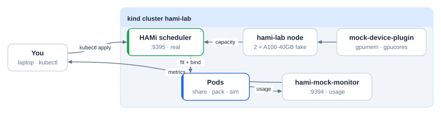
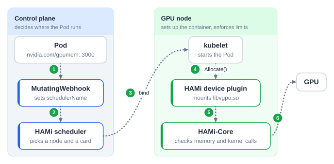
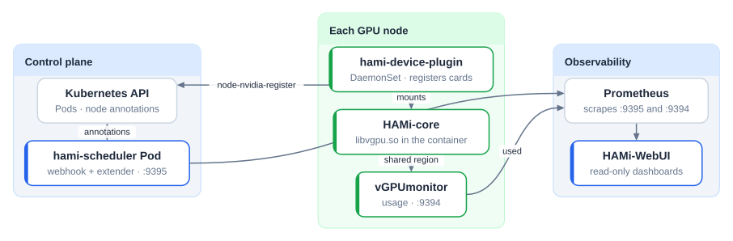
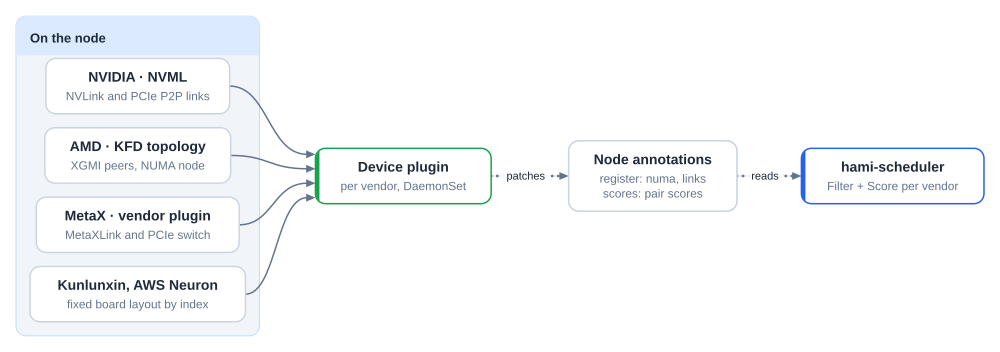
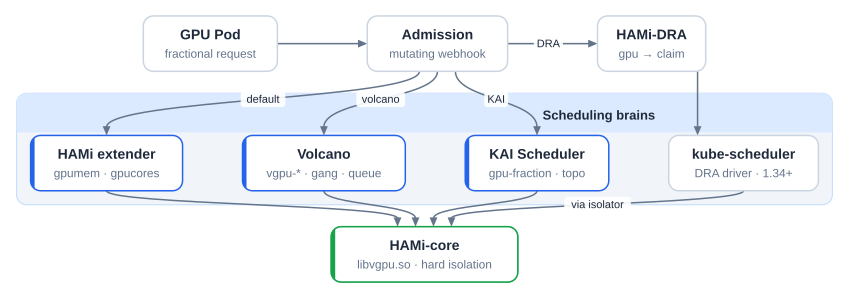
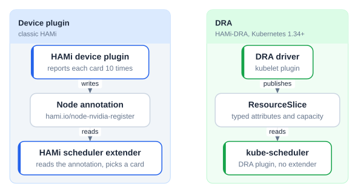
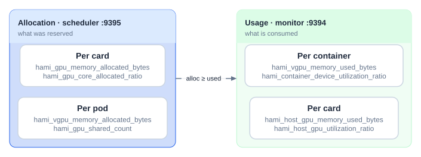
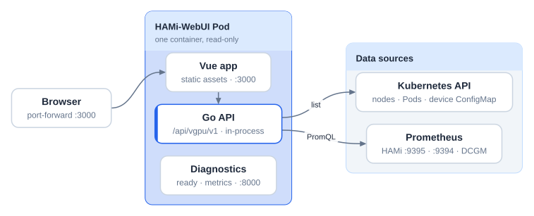

# HAMi 实验：没有 GPU 也能共享 GPU

一个自学式实验，在 Kubernetes 中用 HAMi 共享 GPU。任何笔记本都能运行：HAMi 调度器是真的，GPU 是模拟的。约 80 分钟内，你会在 kind 上安装 HAMi，在 Pod 之间共享模拟的 A100 卡，对比调度策略，了解拓扑、其他调度器和 DRA 的位置，并读懂 HAMi 暴露的两组指标。

- [mock-device-plugin](https://github.com/Project-HAMi/mock-device-plugin) 根据节点注解注册 `nvidia.com/gpumem` 和 `nvidia.com/gpucores` 容量。
- [hami-mock-monitor](https://github.com/fishman/hami-mock-monitor) 用负载源代替 GPU，输出 HAMi 的用量指标（通常由 vGPUmonitor 和 HAMi-core 产生）。

没有 GPU 就**没有**容器内的显存与算力隔离，这部分由 HAMi-core 负责。想在真实硬件上体验，参见 AMD 笔记本的脚注[^amd]。



2026-11-09 测试通过：kind 0.33、kubectl 1.37、helm 4.3、HAMi chart 2.10.0、hami-mock-monitor 0.2.0。

## 准备

- Linux 虚拟机中的 Docker（macOS 上用 Docker Desktop、OrbStack 或 Colima），4 CPU、8 GB 空闲内存。macOS 原生容器无法配合 kind 使用，参见[安装实验工具](install-tools.md)。
- `kind`、`kubectl`、`helm`、`jq`、`git`，参见[安装实验工具](install-tools.md)。
- 仅在需要编译 HAMi 或贡献代码时才需要 Go 1.27+。

请在**课前一次性拉好镜像**，不要到现场再拉：

```bash
git clone https://github.com/Project-HAMi/hami-workshop
cd hami-workshop/examples/hami-lab
docker pull kindest/node:v1.37.0
docker pull docker.io/projecthami/hami:v2.10.0
docker pull docker.io/projecthami/mock-device-plugin:latest
docker pull docker.io/liangjw/kube-webhook-certgen:v1.1.1
docker pull busybox:1.36
docker pull ghcr.io/llm-d/llm-d-inference-sim:v0.12.0
docker pull ghcr.io/fishman/hami-mock-monitor:0.2.0
```

`setup.sh` 会把本地已有的镜像导入 kind，只拉取缺少的。

## HAMi 如何协同工作

Pod 请求一张卡的一部分。webhook 把它路由给 HAMi 调度器，调度器选出节点和卡。设备插件配置容器，HAMi-core 强制执行限额：





## 实验 1：安装 HAMi

```bash
./setup.sh
```

脚本做的事：

1. 创建 kind 集群 `hami-lab`，给节点打标签 `gpu=on`。
2. 把预先拉好的镜像导入集群。
3. 安装 HAMi 2.10.0，关闭真实设备插件，开启 mock 插件。
4. 模拟两张 A100-40GB：计数资源 `nvidia.com/gpu=20`（2 张卡 x 10 份切分），以及来自 `fake-gpus.json` 的节点注解 `hami.io/node-nvidia-register`，这正是真实设备插件读取 NVML 后写入的内容。
5. 安装 hami-mock-monitor，设置 `completeBinds=true`。

结束时应看到：

```json
{ "nvidia.com/gpu": "20", "nvidia.com/gpucores": "200",
  "nvidia.com/gpumem": "81920", "nvidia.com/gpumem-percentage": "200" }
```

四处看看：

```bash
kubectl -n kube-system get pods | grep hami
kubectl -n kube-system get cm hami-scheduler-device -o yaml | less
kubectl get node hami-lab-control-plane -o jsonpath='{.metadata.annotations.hami\.io/node-nvidia-register}' | jq
```

**思考题。** 调度器从哪里获得卡的列表？如果 `health` 为 `false` 会有什么变化？

## 实验 2：共享 GPU

```bash
kubectl apply -f share.yaml -f too-big.yaml
kubectl wait --for=condition=Ready pod/share-1 pod/share-2 pod/share-3 --timeout=120s
kubectl get events --field-selector involvedObject.name=too-big | tail -2
# 0/1 nodes are available: 1 2/2 CardInsufficientMemory.
for p in share-1 share-2 share-3; do
  echo -n "$p "; kubectl get pod $p -o jsonpath='{.metadata.annotations.hami\.io/vgpu-devices-allocated}{"\n"}'
done
# share-1 GPU-mock-1,NVIDIA,15000,30:;
# share-2 GPU-mock-0,NVIDIA,15000,30:;
# share-3 GPU-mock-1,NVIDIA,15000,30:;
```

`too-big` 请求 45000 MB，超过任何一张 40960 MB 的卡，因此一直 `Pending`。分配格式为每个设备 `uuid,type,memory_mb,cores:`，每个容器以 `;` 结尾。

你刚刚看到的链路：

1. 准入 **webhook** 把 `schedulerName` 改写为 `hami-scheduler`。
2. 调度器 **extender** 在 `Filter` 阶段读取 `hami.io/node-nvidia-register`，逐卡检查显存和算力余量，选出卡的 UUID。
3. 在 `Bind` 阶段，它把 `hami.io/vgpu-devices-allocated` 写到 Pod 上，设置 `hami.io/bind-phase=allocating`，并获取节点锁 `hami.io/mutex.lock`。
4. 设备插件的 `Allocate` 挂载设备和 `libvgpu.so`，标记 `success` 并释放锁。mock 插件跳过了这一步，所以 hami-mock-monitor 提供了 `completeBinds`。没有它，下一个 Pod 最多要等 5 分钟才能拿到锁。

## 实验 3：调度策略

| 维度 | 注解 | binpack | spread |
| --- | --- | --- | --- |
| 选哪个节点 | `hami.io/node-scheduler-policy` | 用更少的节点 | 分散到各节点 |
| 节点上选哪张卡 | `hami.io/gpu-scheduler-policy` | 同一张卡 | 分散到各卡 |

```bash
kubectl delete -f share.yaml -f too-big.yaml
kubectl apply -f binpack.yaml
kubectl wait --for=condition=Ready pod/pack-1 pod/pack-2 --timeout=120s
for p in pack-1 pack-2; do
  echo -n "$p "; kubectl get pod $p -o jsonpath='{.metadata.annotations.hami\.io/vgpu-devices-allocated}{"\n"}'
done
kubectl delete -f binpack.yaml
kubectl apply -f spread.yaml
kubectl wait --for=condition=Ready pod/spread-1 pod/spread-2 --timeout=120s
for p in spread-1 spread-2; do
  echo -n "$p "; kubectl get pod $p -o jsonpath='{.metadata.annotations.hami\.io/vgpu-devices-allocated}{"\n"}'
done
```

binpack 把两个 Pod 放在同一张卡上，spread 则每张卡放一个。

### 拓扑信息从哪里来

调度器从不直接读取硬件。各厂商的设备插件在节点上读取硬件信息并写成节点注解，调度器据此给卡打分：



- **NVIDIA：** 设置 `ENABLE_TOPOLOGY_SCORE=true` 后，插件通过 NVML（NVLink、PCIe）为每一对卡打分，写入 `hami.io/node-nvidia-score`。使用策略 `topology-aware` 时，请求一张卡会得到连接最少的那张，请求 N 张卡则得到连接最好的一组。
- **AMD：** `hami.io/node-amd-register` 中每个 GPU 带有 `xgmiPeers` 和 `numa`。Pod 可以请求 `amd.com/numa-bind`、`amd.com/link-bind` 或 `topology-aware`。
- **MetaX：** 厂商插件写入 `metax-tech.com/gpu.topology.scores` 和 `.losses`。优先 MetaXLink，其次 PCIe switch。
- **昆仑芯、AWS Neuron：** 没有链路数据。布局固定，调度器根据卡的序号推导。

## 实验 4：默认调度器之外

HAMi 是容量模型加上隔离库 HAMi-core。其他调度器可以替换放置逻辑，同时保留隔离：



- **KAI Scheduler**（v0.16.4+）：`global.gpuSharing=true` 和 `binder.plugins.hamicore.enabled=true`。KAI 负责放置，HAMi-core 根据 `gpu-fraction` 或 `gpu-memory` 限制显存。
- **Volcano**：`deviceshare` 插件加 volcano-vgpu-device-plugin，资源为 `volcano.sh/vgpu-*`。在共享 GPU 上提供 gang 调度和队列上限。每个 GPU 节点只运行一条设备插件路径。可尝试 [Volcano vGPU 教程](https://project-hami.io/tutorials/labs/volcano-vgpu-gang-queue)。

### DRA



DRA 有四种对象：**ResourceSlice**（由驱动发布，包含带属性和容量的设备）、**DeviceClass**（用 CEL 选择设备，HAMi 使用 `hami-core-gpu.project-hami.io`）、**ResourceClaim**（Pod 的请求）和 **ResourceClaimTemplate**（每个 Pod 一个 claim）。借助可消耗容量（`DRAConsumableCapacity`，自 1.36 起默认开启），一张卡可以服务多个 claim：

```yaml
apiVersion: resource.k8s.io/v1
kind: ResourceClaim
metadata: { name: single-gpu-0 }
spec:
  devices:
    requests:
    - name: single-gpu
      exactly:
        deviceClassName: hami-core-gpu.project-hami.io
        capacity:
          requests: { cores: 30, memory: "4Gi" }
```

[HAMi-DRA](https://github.com/Project-HAMi/HAMi-DRA) 保留 HAMi 的 Pod 写法：webhook 把 `nvidia.com/gpu` 请求改写为 claim。


它需要 Kubernetes 1.34+，以及 containerd 或 CRI-O 中的 CDI，因此在本实验中仅作阅读。

## 收尾：预留不等于使用



```bash
./metrics.sh scheduler
./metrics.sh monitor
kubectl apply -f sim.yaml
watch -n 5 "./metrics.sh monitor | grep 'pod=\"sim\"'"
```

`sim` 是兼容 vLLM 的模拟器。它的利用率在 0 到 33 之间波动，而显存始终保持在限额的 0.9 倍，因为 vLLM 会预分配 KV cache。

**思考题。** 一张卡显示 73% 显存已分配，但只用了 20%。容量看板应该用哪个数字，成本报表又该用哪个？

## 可选：HAMi WebUI



```bash
docker pull projecthami/hami-webui-be-oss:v1.3.0 projecthami/hami-webui-fe-oss:v1.3.0   # once, at home
helm repo add prometheus-community https://prometheus-community.github.io/helm-charts
helm repo add hami-webui https://project-hami.github.io/HAMi-WebUI
helm upgrade --install prometheus prometheus-community/kube-prometheus-stack \
  --version 75.15.1 -n monitoring --create-namespace --set grafana.enabled=false --wait
kubectl apply -f monitoring.yaml -f webui-rules.yaml
helm upgrade --install my-hami-webui hami-webui/hami-webui \
  --set externalPrometheus.enabled=true \
  --set externalPrometheus.address="http://prometheus-kube-prometheus-prometheus.monitoring.svc.cluster.local:9090" \
  --set dcgm-exporter.enabled=false \
  --set image.frontend.digest="" --set image.backend.digest="" \
  -n kube-system --wait
kubectl -n kube-system port-forward svc/my-hami-webui 3000:3000
```

`webui-rules.yaml` 把调度器和 mock monitor 较新的指标名记录为 WebUI 查询所用的名称。没有它，分配和用量面板会一直是空的。

如果想改 WebUI：

```bash
git clone https://github.com/Project-HAMi/HAMi-WebUI && cd HAMi-WebUI
make bootstrap && make -C server bootstrap
make -C server run   # Go API on :8000, point server/config/config.yaml at Prometheus
make dev             # Vite on :3000
make verify && make -C server verify
```

## 参与贡献

- **HAMi**：`make test`。从 `pkg/device/nvidia/device.go`（`Fit`）或 `pkg/scheduler/scheduler.go`（`Filter`、`Bind`）入手。
- **HAMi-DRA**：把 `nvidia.com/gpu` 请求转换为 DRA claim 的 webhook。
- **mock-device-plugin**：在 `Allocate` 中完成绑定，或增加一个厂商。
- **hami-mock-monitor**：支持其他厂商，为实验做一个 Grafana 看板。

提交需要 `git commit -s`。找 `good first issue`，然后提一个 draft PR。

## 清理

```bash
kind delete cluster --name hami-lab
```

[^amd]: 如果你的笔记本有 AMD APU（例如带 Radeon 780M 核显的 Ryzen），可以在真实硬件上看到 HAMi-core 风格的隔离：[Local AMD GPU with HAMi](local-amd-gpu.md) 在一块集成 GPU 上用 ROCm 运行两个 llama.cpp 服务，每个限制为一半计算单元和 2 GiB 显存。需要带 `/dev/kfd` 的 Linux；在 `gfx1103` 上使用 `HSA_OVERRIDE_GFX_VERSION=11.0.0`。
