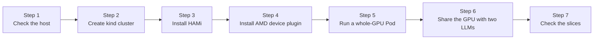
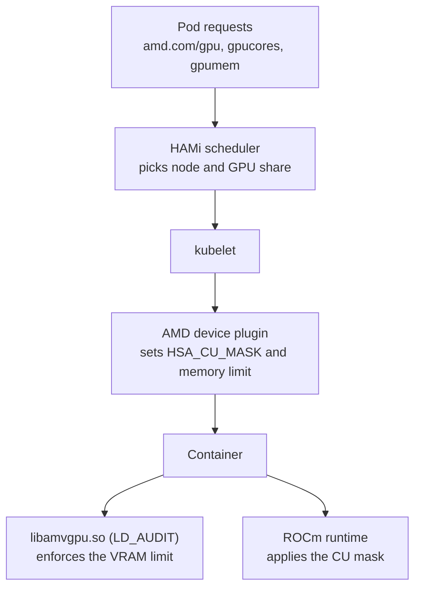

# Lab 3: Local AMD GPU with HAMi (Optional)

The other labs in this workshop run on any laptop, with a fake GPU. This lab is for people who have an AMD GPU in their machine, including the integrated Radeon graphics in Ryzen laptops. It builds a local [kind](https://kind.sigs.k8s.io/) cluster that sees your real GPU, installs HAMi with the [HAMi AMD device plugin](https://github.com/Project-HAMi/amd-device-plugin), and runs two copies of the Qwen3-0.6B language model that share one GPU, each with its own slice of compute units and memory.

If you don't have an AMD GPU, use [Lab 2: Local Fake GPU Setup](local-fake-gpu.md) instead.

## What You'll Get

- A kind cluster whose node has `/dev/kfd` and `/dev/dri` from your machine
- The HAMi scheduler from HAMi master (after v2.10.0) and the AMD device plugin from its `main` branch
- Your GPU published as `amd.com/gpu`, with `amd.com/gpucores` and `amd.com/gpumem` for slicing
- Two llama.cpp servers running Qwen3-0.6B on the same GPU, each limited to half the compute units and 2048 MiB of VRAM
- A failed allocation that shows the memory limit is enforced inside the container

This lab was run end to end on an AMD Ryzen 7 7840U with Radeon 780M graphics (`gfx1103`, 12 compute units), kernel 7.1, ROCm 7.2.4, kind v0.32.0 and Kubernetes v1.36.1. Example outputs below come from that machine.

## Installation Overview



| Step | Purpose | What It Solves |
| ------ | ------ | ------------- |
| Check the host | Confirm the GPU and driver | Make sure `/dev/kfd` and `/dev/dri` exist |
| Create kind cluster | Pass the GPU into a local node | Kubernetes can see the GPU device files |
| Install HAMi | Deploy the HAMi scheduler and webhook | Pods get placed by GPU share, cores and memory |
| Install AMD device plugin | Register the GPU with kubelet and HAMi | The node reports `amd.com/gpu` and its VRAM and CUs |
| Run a whole-GPU Pod | Smoke test | A Pod sees the GPU through the plugin |
| Share the GPU with two LLMs | Real workload | Two Pods run a model on one GPU at the same time |
| Check the slices | Verify isolation | Compute units don't overlap and memory is capped |



## Prerequisites

- Linux on x86_64 with an AMD GPU and the `amdgpu` kernel driver loaded
- Docker, [kind](https://kind.sigs.k8s.io/docs/user/quick-start/#installation), `kubectl`, Helm 3 and `git`
- About 10 GB of free disk for container images
- Access to Docker Hub, GHCR, GitHub and `registry.k8s.io`

You don't need ROCm installed on the host. ROCm user space comes inside the container images. The host only needs the kernel driver.

> **Pull images before the workshop.** On a slow link the images in this lab take a long time to download. On the test machine (about 1.5 to 3.5 MB/s) the AMD device plugin image took about 40 minutes. Pull them at home if you can, see [Pre-pull images](#pre-pull-images).

## Why llama.cpp and not vLLM

The goal of this lab is to see HAMi share a real GPU, on a laptop. The serving runtime only has to be a ROCm program that allocates GPU memory through HIP, so HAMi's memory hook can see it. That leaves image size as the deciding factor:

| Runtime | Image | Compressed size |
| ------ | ------ | ------ |
| llama.cpp `llama-server` (this lab) | `ghcr.io/fishing-agents/hami-workshop:qwen3-0.6b-llamacpp-v0.7.0-rocm7.2.4`, model included | 1.57 GB |
| ROCm base image the server runs in | `rocm/dev-ubuntu-24.04:7.2.4`, shared with Step 5 | about 1.2 GB |
| Ollama | `ollama/ollama:rocm`, model downloaded separately | 1.45 GB |
| vLLM, AMD RDNA3 build | `rocm/vllm:rocm7.12.0_gfx110X-all_..._vllm_0.16.0` | 8.6 GB |
| vLLM, upstream release | `vllm/vllm-openai-rocm:v0.32.0` | 11.6 GB |
| vLLM, upstream nightly | `vllm/vllm-openai-rocm:nightly` | 18.0 GB |

Unpacked, a vLLM image needs several times its compressed size on disk, more than many laptops have free. llama.cpp is the inference engine that Ollama is built on, and either one fits. This lab uses `llama-server` directly because the binary and the model ship as one small image, and it runs in the same ROCm base image as the whole-GPU test in Step 5. Ollama with `qwen3:0.6b` works the same way if you prefer it.

If you have the disk space and want vLLM, see [Optional: vLLM](#optional-vllm).

## Step 1: Check the Host

The GPU must be visible as device files:

```bash
ls -l /dev/kfd /dev/dri
```

Example output:

```plaintext
crw-rw-rw- 1 root render 239,   0 Oct 19 22:30 /dev/kfd

/dev/dri:
drwxr-xr-x 2 root root        80 Oct 17 00:23 by-path
crw-rw----+ 1 root video  226,   1 Oct 23 11:56 card1
crw-rw-rw- 1 root render 226, 128 Oct 19 22:30 renderD128
```

If `/dev/kfd` is missing, the `amdgpu` driver isn't loaded or your GPU isn't supported by the kernel's compute driver.

Check how much VRAM the GPU has. On integrated graphics this is the memory your BIOS reserves for the GPU:

```bash
cat /sys/class/drm/card*/device/mem_info_vram_total
```

```plaintext
17179869184
```

That is 16 GiB on the test machine. If you have ROCm on the host, `rocminfo | grep gfx` shows the GPU architecture, for example `gfx1103` for the Radeon 780M.

## Step 2: Create the kind Cluster

All files for this lab are in `examples/03-local-amd-gpu/`. The kind config mounts the two device paths into the node container:

```yaml
kind: Cluster
apiVersion: kind.x-k8s.io/v1alpha4
name: hami-amd
nodes:
- role: control-plane
  extraMounts:
  - hostPath: /dev/kfd
    containerPath: /dev/kfd
  - hostPath: /dev/dri
    containerPath: /dev/dri
```

```bash
kind create cluster --config examples/03-local-amd-gpu/kind.yaml --wait 120s
```

Check that the node sees the GPU:

```bash
docker exec hami-amd-control-plane ls /dev/kfd /dev/dri
```

```plaintext
/dev/kfd

/dev/dri:
by-path
card1
renderD128
```

## Step 3: Install HAMi

This lab uses HAMi master, because AMD fixes landed after v2.10.0. The Helm repository only publishes releases, so install the chart from a git checkout and pin the image to the same commit. HAMi publishes an image for every master commit as `projecthami/hami:<short sha>`.

```bash
git clone https://github.com/Project-HAMi/HAMi
git -C HAMi checkout 33b7220
```

`examples/03-local-amd-gpu/hami-values.yaml`:

```yaml
global:
  # Master build after v2.10.0. Matches the chart checked out at the same commit.
  imageTag: "33b7220"

scheduler:
  kubeScheduler:
    image:
      # Empty tag follows the cluster's Kubernetes version.
      # The default registry is an Alibaba Cloud mirror; outside China use upstream.
      registry: registry.k8s.io
      repository: kube-scheduler

devicePlugin:
  # HAMi's bundled plugin is for NVIDIA. The amd-gpu chart registers amd.com/gpu.
  enabled: false
```

> In mainland China, delete the two `registry` and `repository` lines to keep the chart's default mirror.

```bash
helm install hami ./HAMi/charts/hami -n kube-system \
    -f examples/03-local-amd-gpu/hami-values.yaml --wait --timeout 10m
kubectl -n kube-system get pods -l app.kubernetes.io/instance=hami
```

```plaintext
NAME                              READY   STATUS    RESTARTS   AGE
hami-scheduler-6dcdc7bd9b-ld9zq   2/2     Running   0          3m10s
```

## Step 4: Install the AMD Device Plugin

The device plugin chart and image must come from the same commit. Its CI publishes `ghcr.io/project-hami/amd-device-plugin:sha-<short sha>` for every commit on `main`.

```bash
git clone https://github.com/Project-HAMi/amd-device-plugin
git -C amd-device-plugin checkout 35c84ab
helm install amd-gpu ./amd-device-plugin/helm/amd-gpu -n kube-system \
    --set dp.image.tag=sha-35c84ab
kubectl -n kube-system wait --for=condition=Ready pod -l name=amd-gpu-dp-ds --timeout=60m
```

The long timeout is for the image pull: the plugin image is built on a full ROCm image.

Read the plugin log:

```bash
kubectl -n kube-system logs ds/amd-gpu-device-plugin-daemonset | grep -E 'ROCr UUID|dmem|node-amd-register|Registration'
```

```plaintext
plugin.go:271] dmem: controller or systemd kubepods.slice not found under /sys/fs/cgroup; sliced VRAM is capped by libamvgpu only
plugin.go:656] GPU 0000:65:00.0 has no ROCr UUID for renderD128; using its container-local index
plugin.go:405] patch node with the following annos map[hami.io/node-amd-register:[{"id":"000015bf-0000-1000-8000-000000000000","index":1,"count":10,"devmem":16384,"devcore":12,"type":"AMD Radeon 780M Graphics","numa":-1,"health":true,"devicevendor":"amd","custominfo":{"computeQueues":8,"cuPerWGP":2,"pciBDF":"0000:65:00.0"}}]]
plugin.go:140] gpu: Registration for endpoint amd.com_gpu
```

What this tells you:

- `count: 10`: up to 10 Pods can share this GPU
- `devmem: 16384` and `devcore: 12`: HAMi schedules against 16 GiB of VRAM and 12 compute units
- `cuPerWGP: 2`: on RDNA GPUs compute units come in pairs, so CU slices are rounded up to whole pairs
- No ROCr UUID: integrated GPUs often have none, and the plugin falls back to the device index
- `dmem` skipped: the kernel's dmem cgroup cap is not found inside kind, so VRAM limits come from the `libamvgpu.so` hook only

```bash
kubectl get node hami-amd-control-plane -o jsonpath='{.status.allocatable.amd\.com/gpu}{"\n"}'
```

```plaintext
10
```

## Step 5: Run a Whole-GPU Pod

`examples/03-local-amd-gpu/whole-gpu-pod.yaml` asks for one GPU and prints what the container sees:

```yaml
apiVersion: v1
kind: Pod
metadata:
  name: rocminfo
spec:
  restartPolicy: Never
  containers:
  - name: rocminfo
    image: rocm/dev-ubuntu-24.04:7.2.4
    command: ["sh", "-c", "env | grep -E 'ROCR|HIP_|HSA_' ; rocminfo | grep -E 'Marketing Name|gfx|Compute Unit'"]
    resources:
      limits:
        amd.com/gpu: 1
```

```bash
kubectl apply -f examples/03-local-amd-gpu/whole-gpu-pod.yaml
kubectl wait --for=jsonpath='{.status.phase}'=Succeeded pod/rocminfo --timeout=30m
kubectl logs rocminfo
```

```plaintext
ROCR_VISIBLE_DEVICES=0
HSA_CU_MASK=0:0-11
HIP_VISIBLE_DEVICES=0
  Marketing Name:          AMD Radeon 780M Graphics
  Compute Unit:            12
  Name:                    gfx1103
```

The Pod was scheduled by `hami-scheduler` and got all 12 compute units (`0:0-11`). A whole-GPU request gets no memory limit and no hook.

```bash
kubectl delete pod rocminfo
```

## Step 6: Share the GPU with Two LLMs

`examples/03-local-amd-gpu/qwen3-llamacpp.yaml` runs two replicas of `llama-server`. Each asks for half the compute units and 2048 MiB of VRAM:

```yaml
        resources:
          limits:
            amd.com/gpu: 1
            amd.com/gpucores: 50
            amd.com/gpumem: 2048
```

The server binary, its ROCm libraries and the Qwen3-0.6B model (Q8_0, 610 MB) come from the payload image, mounted as a read-only [image volume](https://kubernetes.io/docs/tasks/configure-pod-container/image-volumes/). The container itself is the stock ROCm image:

```yaml
      volumes:
      - name: llama
        image:
          reference: ghcr.io/fishing-agents/hami-workshop:qwen3-0.6b-llamacpp-v0.7.0-rocm7.2.4
          pullPolicy: IfNotPresent
      containers:
      - name: llama
        image: rocm/dev-ubuntu-24.04:7.2.4
        command: ["/opt/llama/bin/llama-server"]
```

Two settings in the manifest are worth knowing:

- `HSA_OVERRIDE_GFX_VERSION=11.0.0`: `llama-server` is built for `gfx1100`. The 780M is `gfx1103`, which ROCm doesn't list as supported, and the override makes it run `gfx1100` code. Remove it on a GPU that ROCm supports directly. If your GPU is not RDNA3, rebuild the payload for your architecture (see [Rebuild the payload image](#rebuild-the-payload-image)).
- `strategy: Recreate`: the two replicas hold every compute unit. A rolling update would start a new Pod first, and HAMi would refuse it with `CardInsufficientCore`.

```bash
kubectl apply -f examples/03-local-amd-gpu/qwen3-llamacpp.yaml
kubectl rollout status deploy/qwen3-llamacpp --timeout=30m
kubectl get pods -l app=qwen3-llamacpp
```

```plaintext
NAME                              READY   STATUS    RESTARTS   AGE
qwen3-llamacpp-75c88ccb5c-6pl9b   1/1     Running   0          13s
qwen3-llamacpp-75c88ccb5c-ddkdx   1/1     Running   0          26s
```

Ask each one a question:

```bash
for p in $(kubectl get pods -l app=qwen3-llamacpp -o name); do
  kubectl exec $p -- curl -s localhost:8080/v1/chat/completions \
    -H 'Content-Type: application/json' \
    -d '{"messages":[{"role":"user","content":"/no_think What is the capital of France? One word."}],"max_tokens":20,"temperature":0}' \
    | grep -o '"content":"[^"]*"'
done
```

```plaintext
"content":"Paris."
"content":"Paris."
```

`/no_think` turns off Qwen3's reasoning output, so the answer comes back short. Qwen3-0.6B is a very small model and gets some facts wrong, for example it calls Mercury the largest planet. That's the model, not the GPU: the same request on CPU gives the same answer.

## Step 7: Check the Slices

### Compute units

HAMi records each Pod's compute units in an annotation:

```bash
kubectl get pods -l app=qwen3-llamacpp \
  -o custom-columns=NAME:.metadata.name,CU:.metadata.annotations.hami\\.io/amd-cu-allocated
```

```plaintext
NAME                              CU
qwen3-llamacpp-75c88ccb5c-6pl9b   {"000015bf-0000-1000-8000-000000000000":"6-11"}
qwen3-llamacpp-75c88ccb5c-ddkdx   {"000015bf-0000-1000-8000-000000000000":"0-5"}
```

Pick the first Pod and look inside. The plugin set the matching ROCm mask and memory limit:

```bash
POD=$(kubectl get pods -l app=qwen3-llamacpp -o name | head -1)
kubectl exec $POD -- sh -c 'env | grep -E "HSA_CU_MASK|HIP_DEVICE_MEMORY_LIMIT|LD_AUDIT"'
```

```plaintext
HIP_DEVICE_MEMORY_LIMIT_0=2048m
HSA_CU_MASK=0:6-11
LD_AUDIT=/usr/local/vgpu/libamvgpu.so
```

The two masks, `0-5` and `6-11`, don't overlap. Each Pod runs on 6 of the 12 compute units.

### Memory

Ask llama.cpp what GPU it sees:

```bash
kubectl exec $POD -- /opt/llama/bin/llama-server --list-devices
```

```plaintext
Available devices:
  ROCm0: AMD Radeon 780M Graphics (2048 MiB, 1191 MiB free)
```

The GPU has 16 GiB, but the container sees 2048 MiB: the `libamvgpu.so` hook answers memory queries with the Pod's limit. Now try to use more than that. This starts a second server in the same container with a large context and automatic fitting turned off:

```bash
kubectl exec $POD -- sh -c \
  '/opt/llama/bin/llama-server -m /opt/llama/models/Qwen3-0.6B-Q8_0.gguf --port 8082 -ngl 99 -c 40960 -fit off 2>&1 | grep -iE "OOM|failed to allocate"'
```

```plaintext
[HAMI-core-hip Error(pid:112 tid:112 .../hip_multiprocess_memory_limit.c:531)]: Device 0 OOM: usage 1531744128 + alloc 4697620480 = 6229364608 > limit 2147483648
E ggml_backend_buft_alloc_buffer_n_default: failed to allocate ROCm0 buffer of size 4697620480
```

The hook counted the 1.5 GB the first server already uses, added the 4.4 GB request, and refused it because the total is over the 2 GiB limit. The GPU still had plenty of free memory.

## Optional: vLLM

`examples/03-local-amd-gpu/qwen3-vllm.yaml` runs the same two-slice setup with vLLM and `Qwen/Qwen3-0.6B`, using `vllm/vllm-openai-rocm:v0.32.0` (11.6 GB compressed). It follows the device plugin's own vLLM example: `hostIPC`, a memory-backed `/dev/shm`, `seccomp: Unconfined` and `SYS_PTRACE`. The model downloads from Hugging Face on first start into a cache shared by both replicas.

```bash
kubectl delete -f examples/03-local-amd-gpu/qwen3-llamacpp.yaml
kubectl apply -f examples/03-local-amd-gpu/qwen3-vllm.yaml
```

This manifest has not been run on the Radeon 780M. The upstream image ships `gfx1100` kernels, so it relies on `HSA_OVERRIDE_GFX_VERSION=11.0.0` like the llama.cpp setup. AMD's `rocm/vllm` `gfx110X-all` build (8.6 GB) includes RDNA3 integrated GPUs directly and is the smaller choice if you only target RDNA3.

## Pre-pull Images

To pull everything into the kind node before the workshop, after Step 2:

```bash
for img in \
  docker.io/projecthami/hami:33b7220 \
  registry.k8s.io/kube-scheduler:v1.36.1 \
  ghcr.io/project-hami/amd-device-plugin:sha-35c84ab \
  docker.io/rocm/dev-ubuntu-24.04:7.2.4 \
  ghcr.io/fishing-agents/hami-workshop:qwen3-0.6b-llamacpp-v0.7.0-rocm7.2.4; do
  docker exec hami-amd-control-plane crictl pull $img
done
```

Use the kube-scheduler tag that matches your cluster version (`kubectl version`).

## Rebuild the Payload Image

The payload image was built inside the cluster by `examples/03-local-amd-gpu/llama-build-job.yaml`. The Job uses the same `rocm/dev-ubuntu-24.04:7.2.4` image, installs hipBLAS and rocBLAS, compiles llama.cpp v0.7.0 for one GPU architecture, and writes the binary, the extra libraries, the rocBLAS kernels for that architecture and the model to `/var/lib/hami-lab/llama` on the node. To build for another GPU, change `GPU_TARGET` (for example `gfx1030` or `gfx1201`), then:

```bash
kubectl apply -f examples/03-local-amd-gpu/llama-build-job.yaml
kubectl wait --for=condition=Complete job/llama-build --timeout=2h
docker cp hami-amd-control-plane:/var/lib/hami-lab/llama ./llama
docker build -f examples/03-local-amd-gpu/Dockerfile.llama -t <your-registry>/hami-workshop:<tag> ./llama
```

The build took about 40 minutes on the test machine, most of it downloading packages. Delete the Job when it's done: its container still holds several GB of build packages.

## Known Issues

| Symptom | Cause | What to do |
| ------ | ------ | ------ |
| `Memory access fault by GPU node-1 ... on address (nil)` on the very first start | Seen once, when both replicas started at the same time on a fresh node | Kubernetes restarts the container and it starts cleanly. It did not come back on later starts |
| New Pod stays `Pending` with `CardInsufficientCore` | The GPU's compute units are all booked | Use `strategy: Recreate`, or ask for fewer `amd.com/gpucores` |
| `invalid argument: --model=...` | llama.cpp doesn't accept `--flag=value` | Pass each flag and value as separate arguments |
| Plugin log says dmem was skipped | kind hides the kubelet's cgroup layout from the plugin | Expected in kind. The `libamvgpu.so` hook still enforces `amd.com/gpumem` |
| A sliced Pod ignores its memory limit | The hook needs glibc 2.34 or newer in the container image | Use an Ubuntu 22.04 or newer based image, not Alpine |

## Clean Up

```bash
kubectl delete -f examples/03-local-amd-gpu/qwen3-llamacpp.yaml
helm uninstall amd-gpu -n kube-system
helm uninstall hami -n kube-system
kind delete cluster --name hami-amd
```

Deleting the cluster also deletes every image pulled into the node.
