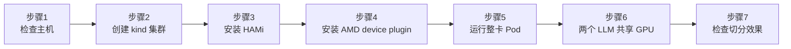
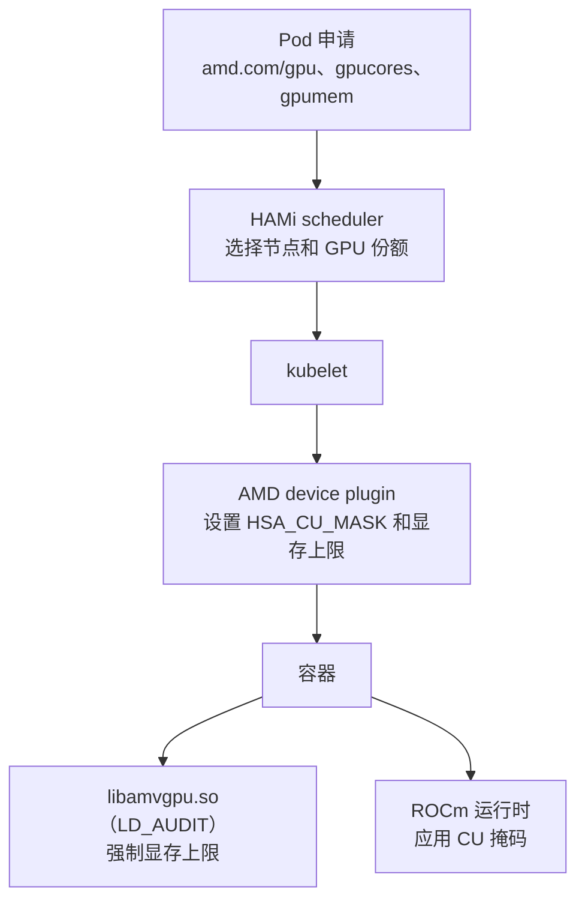

# 实验 3: 本地 AMD GPU 运行 HAMi（可选）

本工作坊的其他实验用 fake GPU，任何笔记本都能跑。本实验面向机器里有 AMD GPU 的同学，包括 Ryzen 笔记本里的 Radeon 核显。我们会搭建一个能看到真实 GPU 的本地 [kind](https://kind.sigs.k8s.io/) 集群，安装 HAMi 和 [HAMi AMD device plugin](https://github.com/Project-HAMi/amd-device-plugin)，然后在同一块 GPU 上运行两个 Qwen3-0.6B 语言模型实例，每个实例拿到自己的一份计算单元和显存。

如果没有 AMD GPU，请使用 [实验 2: 本地 Fake GPU 安装](local-fake-gpu.md)。

## 你将得到什么

- 一个 kind 集群，节点里有本机的 `/dev/kfd` 和 `/dev/dri`
- HAMi master（v2.10.0 之后）的调度器，以及 AMD device plugin `main` 分支
- GPU 以 `amd.com/gpu` 上报，并可以用 `amd.com/gpucores` 和 `amd.com/gpumem` 切分
- 两个 llama.cpp 服务在同一块 GPU 上运行 Qwen3-0.6B，各自限制为一半计算单元和 2048 MiB 显存
- 一次失败的显存分配，证明容器内的显存限制确实生效

本实验已在 AMD Ryzen 7 7840U（Radeon 780M 核显，`gfx1103`，12 个计算单元）、内核 7.1、ROCm 7.2.4、kind v0.32.0、Kubernetes v1.36.1 上完整跑通。下文的示例输出都来自这台机器。

## 安装全景图



| 步骤 | 目的 | 解决什么问题 |
| ------ | ------ | ------------- |
| 检查主机 | 确认 GPU 和驱动 | 确保 `/dev/kfd` 和 `/dev/dri` 存在 |
| 创建 kind 集群 | 把 GPU 传进本地节点 | 让 Kubernetes 看到 GPU 设备文件 |
| 安装 HAMi | 部署 HAMi 调度器和 webhook | 按 GPU 份数、算力和显存放置 Pod |
| 安装 AMD device plugin | 向 kubelet 和 HAMi 注册 GPU | 节点上报 `amd.com/gpu` 以及显存和 CU 数量 |
| 运行整卡 Pod | 冒烟测试 | Pod 能通过插件看到 GPU |
| 两个 LLM 共享 GPU | 真实负载 | 两个 Pod 同时在一块 GPU 上运行模型 |
| 检查切分效果 | 验证隔离 | 计算单元不重叠，显存有上限 |



## 前提条件

- x86_64 Linux，带 AMD GPU，并已加载 `amdgpu` 内核驱动
- Docker、[kind](https://kind.sigs.k8s.io/docs/user/quick-start/#installation)、`kubectl`、Helm 3 和 `git`
- 约 10 GB 可用磁盘空间存放容器镜像
- 能访问 Docker Hub、GHCR、GitHub 和 `registry.k8s.io`

主机上不需要安装 ROCm。ROCm 用户态组件都在容器镜像里，主机只需要内核驱动。

> **请提前拉取镜像。** 网络慢的时候，本实验的镜像下载很耗时。在测试机上（约 1.5 到 3.5 MB/s），AMD device plugin 镜像下载了大约 40 分钟。尽量在家里提前拉好，参见 [提前拉取镜像](#pre-pull-images)。

## 为什么用 llama.cpp 而不是 vLLM

本实验的目标是在笔记本上看到 HAMi 共享一块真实 GPU。推理服务只要是通过 HIP 分配显存的 ROCm 程序就行，这样 HAMi 的显存钩子才能看到它。剩下的决定因素就是镜像大小：

| 运行时 | 镜像 | 压缩后大小 |
| ------ | ------ | ------ |
| llama.cpp `llama-server`（本实验） | `ghcr.io/fishing-agents/hami-workshop:qwen3-0.6b-llamacpp-v0.7.0-rocm7.2.4`，包含模型 | 1.57 GB |
| 服务运行所用的 ROCm 基础镜像 | `rocm/dev-ubuntu-24.04:7.2.4`，与步骤 5 共用 | 约 1.2 GB |
| Ollama | `ollama/ollama:rocm`，模型另行下载 | 1.45 GB |
| vLLM，AMD RDNA3 版本 | `rocm/vllm:rocm7.12.0_gfx110X-all_..._vllm_0.16.0` | 8.6 GB |
| vLLM，上游正式版 | `vllm/vllm-openai-rocm:v0.32.0` | 11.6 GB |
| vLLM，上游 nightly | `vllm/vllm-openai-rocm:nightly` | 18.0 GB |

vLLM 镜像解压后占用的磁盘是压缩大小的好几倍，超过很多笔记本的剩余空间。llama.cpp 是 Ollama 底层的推理引擎，两者都足够小。本实验直接使用 `llama-server`，因为可执行文件和模型可以打包成一个小镜像，并且和步骤 5 的整卡测试使用同一个 ROCm 基础镜像。如果你更喜欢 Ollama，用 `qwen3:0.6b` 也是同样的效果。

如果磁盘足够并且想用 vLLM，参见 [可选：vLLM](#optional-vllm)。

## 步骤 1: 检查主机

GPU 必须以设备文件的形式可见：

```bash
ls -l /dev/kfd /dev/dri
```

示例输出：

```plaintext
crw-rw-rw- 1 root render 239,   0 Oct 19 22:30 /dev/kfd

/dev/dri:
drwxr-xr-x 2 root root        80 Oct 17 00:23 by-path
crw-rw----+ 1 root video  226,   1 Oct 23 11:56 card1
crw-rw-rw- 1 root render 226, 128 Oct 19 22:30 renderD128
```

如果没有 `/dev/kfd`，说明 `amdgpu` 驱动没有加载，或者内核的计算驱动不支持你的 GPU。

查看 GPU 显存大小。对于核显，这是 BIOS 为 GPU 预留的内存：

```bash
cat /sys/class/drm/card*/device/mem_info_vram_total
```

```plaintext
17179869184
```

测试机上是 16 GiB。如果主机装了 ROCm，`rocminfo | grep gfx` 可以看到 GPU 架构，比如 Radeon 780M 是 `gfx1103`。

## 步骤 2: 创建 kind 集群

本实验的所有文件都在 `examples/03-local-amd-gpu/`。kind 配置把两个设备路径挂载进节点容器：

```yaml
kind: Cluster
apiVersion: kind.x-k8s.io/v1alpha4
name: hami-amd
nodes:
- role: control-plane
  extraMounts:
  - hostPath: /dev/kfd
    containerPath: /dev/kfd
  - hostPath: /dev/dri
    containerPath: /dev/dri
```

```bash
kind create cluster --config examples/03-local-amd-gpu/kind.yaml --wait 120s
```

确认节点能看到 GPU：

```bash
docker exec hami-amd-control-plane ls /dev/kfd /dev/dri
```

```plaintext
/dev/kfd

/dev/dri:
by-path
card1
renderD128
```

## 步骤 3: 安装 HAMi

本实验使用 HAMi master，因为 AMD 相关修复是在 v2.10.0 之后合入的。Helm 仓库只发布正式版，所以要从 git 检出 chart，并把镜像固定到同一个提交。HAMi 为每个 master 提交发布 `projecthami/hami:<短 sha>` 镜像。

```bash
git clone https://github.com/Project-HAMi/HAMi
git -C HAMi checkout 33b7220
```

`examples/03-local-amd-gpu/hami-values.yaml`：

```yaml
global:
  # Master build after v2.10.0. Matches the chart checked out at the same commit.
  imageTag: "33b7220"

scheduler:
  kubeScheduler:
    image:
      # Empty tag follows the cluster's Kubernetes version.
      # The default registry is an Alibaba Cloud mirror; outside China use upstream.
      registry: registry.k8s.io
      repository: kube-scheduler

devicePlugin:
  # HAMi's bundled plugin is for NVIDIA. The amd-gpu chart registers amd.com/gpu.
  enabled: false
```

> 在中国大陆，删掉 `registry` 和 `repository` 两行，使用 chart 默认的阿里云镜像源。

```bash
helm install hami ./HAMi/charts/hami -n kube-system \
    -f examples/03-local-amd-gpu/hami-values.yaml --wait --timeout 10m
kubectl -n kube-system get pods -l app.kubernetes.io/instance=hami
```

```plaintext
NAME                              READY   STATUS    RESTARTS   AGE
hami-scheduler-6dcdc7bd9b-ld9zq   2/2     Running   0          3m10s
```

## 步骤 4: 安装 AMD device plugin

device plugin 的 chart 和镜像必须来自同一个提交。它的 CI 为 `main` 上每个提交发布 `ghcr.io/project-hami/amd-device-plugin:sha-<短 sha>`。

```bash
git clone https://github.com/Project-HAMi/amd-device-plugin
git -C amd-device-plugin checkout 35c84ab
helm install amd-gpu ./amd-device-plugin/helm/amd-gpu -n kube-system \
    --set dp.image.tag=sha-35c84ab
kubectl -n kube-system wait --for=condition=Ready pod -l name=amd-gpu-dp-ds --timeout=60m
```

超时设置得长，是因为插件镜像基于完整的 ROCm 镜像构建，拉取很慢。

查看插件日志：

```bash
kubectl -n kube-system logs ds/amd-gpu-device-plugin-daemonset | grep -E 'ROCr UUID|dmem|node-amd-register|Registration'
```

```plaintext
plugin.go:271] dmem: controller or systemd kubepods.slice not found under /sys/fs/cgroup; sliced VRAM is capped by libamvgpu only
plugin.go:656] GPU 0000:65:00.0 has no ROCr UUID for renderD128; using its container-local index
plugin.go:405] patch node with the following annos map[hami.io/node-amd-register:[{"id":"000015bf-0000-1000-8000-000000000000","index":1,"count":10,"devmem":16384,"devcore":12,"type":"AMD Radeon 780M Graphics","numa":-1,"health":true,"devicevendor":"amd","custominfo":{"computeQueues":8,"cuPerWGP":2,"pciBDF":"0000:65:00.0"}}]]
plugin.go:140] gpu: Registration for endpoint amd.com_gpu
```

这些信息说明：

- `count: 10`：最多 10 个 Pod 可以共享这块 GPU
- `devmem: 16384` 和 `devcore: 12`：HAMi 按 16 GiB 显存和 12 个计算单元调度
- `cuPerWGP: 2`：RDNA GPU 的计算单元成对出现，所以 CU 切分会向上取整到整对
- 没有 ROCr UUID：核显通常没有，插件会退回使用设备序号
- 跳过 dmem：在 kind 里找不到内核的 dmem cgroup，所以显存上限只由 `libamvgpu.so` 钩子保证

```bash
kubectl get node hami-amd-control-plane -o jsonpath='{.status.allocatable.amd\.com/gpu}{"\n"}'
```

```plaintext
10
```

## 步骤 5: 运行整卡 Pod

`examples/03-local-amd-gpu/whole-gpu-pod.yaml` 申请一块 GPU，并打印容器看到的内容：

```yaml
apiVersion: v1
kind: Pod
metadata:
  name: rocminfo
spec:
  restartPolicy: Never
  containers:
  - name: rocminfo
    image: rocm/dev-ubuntu-24.04:7.2.4
    command: ["sh", "-c", "env | grep -E 'ROCR|HIP_|HSA_' ; rocminfo | grep -E 'Marketing Name|gfx|Compute Unit'"]
    resources:
      limits:
        amd.com/gpu: 1
```

```bash
kubectl apply -f examples/03-local-amd-gpu/whole-gpu-pod.yaml
kubectl wait --for=jsonpath='{.status.phase}'=Succeeded pod/rocminfo --timeout=30m
kubectl logs rocminfo
```

```plaintext
ROCR_VISIBLE_DEVICES=0
HSA_CU_MASK=0:0-11
HIP_VISIBLE_DEVICES=0
  Marketing Name:          AMD Radeon 780M Graphics
  Compute Unit:            12
  Name:                    gfx1103
```

这个 Pod 由 `hami-scheduler` 调度，拿到了全部 12 个计算单元（`0:0-11`）。整卡申请没有显存上限，也不加载钩子。

```bash
kubectl delete pod rocminfo
```

## 步骤 6: 两个 LLM 共享 GPU

`examples/03-local-amd-gpu/qwen3-llamacpp.yaml` 运行两个 `llama-server` 副本，每个申请一半计算单元和 2048 MiB 显存：

```yaml
        resources:
          limits:
            amd.com/gpu: 1
            amd.com/gpucores: 50
            amd.com/gpumem: 2048
```

服务程序、它需要的 ROCm 库和 Qwen3-0.6B 模型（Q8_0，610 MB）都来自 payload 镜像，以只读 [镜像卷](https://kubernetes.io/docs/tasks/configure-pod-container/image-volumes/) 的方式挂载。容器本身使用标准 ROCm 镜像：

```yaml
      volumes:
      - name: llama
        image:
          reference: ghcr.io/fishing-agents/hami-workshop:qwen3-0.6b-llamacpp-v0.7.0-rocm7.2.4
          pullPolicy: IfNotPresent
      containers:
      - name: llama
        image: rocm/dev-ubuntu-24.04:7.2.4
        command: ["/opt/llama/bin/llama-server"]
```

清单里有两个值得了解的设置：

- `HSA_OVERRIDE_GFX_VERSION=11.0.0`：`llama-server` 是为 `gfx1100` 编译的。780M 是 `gfx1103`，ROCm 没有把它列为支持的型号，这个变量让它运行 `gfx1100` 的代码。如果你的 GPU 被 ROCm 直接支持，就删掉它。如果你的 GPU 不是 RDNA3，需要为你的架构重新构建 payload（参见 [重新构建 payload 镜像](#rebuild-the-payload-image)）。
- `strategy: Recreate`：两个副本占满了所有计算单元。滚动更新会先启动一个新 Pod，HAMi 会以 `CardInsufficientCore` 拒绝它。

```bash
kubectl apply -f examples/03-local-amd-gpu/qwen3-llamacpp.yaml
kubectl rollout status deploy/qwen3-llamacpp --timeout=30m
kubectl get pods -l app=qwen3-llamacpp
```

```plaintext
NAME                              READY   STATUS    RESTARTS   AGE
qwen3-llamacpp-75c88ccb5c-6pl9b   1/1     Running   0          13s
qwen3-llamacpp-75c88ccb5c-ddkdx   1/1     Running   0          26s
```

分别向两个副本提问：

```bash
for p in $(kubectl get pods -l app=qwen3-llamacpp -o name); do
  kubectl exec $p -- curl -s localhost:8080/v1/chat/completions \
    -H 'Content-Type: application/json' \
    -d '{"messages":[{"role":"user","content":"/no_think What is the capital of France? One word."}],"max_tokens":20,"temperature":0}' \
    | grep -o '"content":"[^"]*"'
done
```

```plaintext
"content":"Paris."
"content":"Paris."
```

`/no_think` 关闭 Qwen3 的思考输出，让回答保持简短。Qwen3-0.6B 是非常小的模型，有些常识会答错，比如会说水星是最大的行星。这是模型本身的问题，不是 GPU 的问题：同样的请求在 CPU 上得到同样的答案。

## 步骤 7: 检查切分效果

### 计算单元

HAMi 把每个 Pod 分到的计算单元记录在注解里：

```bash
kubectl get pods -l app=qwen3-llamacpp \
  -o custom-columns=NAME:.metadata.name,CU:.metadata.annotations.hami\\.io/amd-cu-allocated
```

```plaintext
NAME                              CU
qwen3-llamacpp-75c88ccb5c-6pl9b   {"000015bf-0000-1000-8000-000000000000":"6-11"}
qwen3-llamacpp-75c88ccb5c-ddkdx   {"000015bf-0000-1000-8000-000000000000":"0-5"}
```

选第一个 Pod 进去看看。插件设置了对应的 ROCm 掩码和显存上限：

```bash
POD=$(kubectl get pods -l app=qwen3-llamacpp -o name | head -1)
kubectl exec $POD -- sh -c 'env | grep -E "HSA_CU_MASK|HIP_DEVICE_MEMORY_LIMIT|LD_AUDIT"'
```

```plaintext
HIP_DEVICE_MEMORY_LIMIT_0=2048m
HSA_CU_MASK=0:6-11
LD_AUDIT=/usr/local/vgpu/libamvgpu.so
```

两个掩码 `0-5` 和 `6-11` 不重叠，每个 Pod 运行在 12 个计算单元中的 6 个上。

### 显存

问问 llama.cpp 看到的是什么 GPU：

```bash
kubectl exec $POD -- /opt/llama/bin/llama-server --list-devices
```

```plaintext
Available devices:
  ROCm0: AMD Radeon 780M Graphics (2048 MiB, 1191 MiB free)
```

GPU 有 16 GiB，但容器看到的是 2048 MiB：`libamvgpu.so` 钩子用 Pod 的上限来回答显存查询。现在试着用超过上限的显存。下面在同一个容器里再启动一个服务，使用很大的上下文，并关闭自动适配：

```bash
kubectl exec $POD -- sh -c \
  '/opt/llama/bin/llama-server -m /opt/llama/models/Qwen3-0.6B-Q8_0.gguf --port 8082 -ngl 99 -c 40960 -fit off 2>&1 | grep -iE "OOM|failed to allocate"'
```

```plaintext
[HAMI-core-hip Error(pid:112 tid:112 .../hip_multiprocess_memory_limit.c:531)]: Device 0 OOM: usage 1531744128 + alloc 4697620480 = 6229364608 > limit 2147483648
E ggml_backend_buft_alloc_buffer_n_default: failed to allocate ROCm0 buffer of size 4697620480
```

钩子把第一个服务已经占用的 1.5 GB 算进去，加上这次申请的 4.4 GB，总量超过 2 GiB 上限，于是拒绝。而此时 GPU 实际还有大量空闲显存。

## 可选：vLLM { #optional-vllm }

`examples/03-local-amd-gpu/qwen3-vllm.yaml` 用 vLLM 和 `Qwen/Qwen3-0.6B` 运行同样的两份切分，镜像是 `vllm/vllm-openai-rocm:v0.32.0`（压缩后 11.6 GB）。它参考了 device plugin 自带的 vLLM 示例：`hostIPC`、基于内存的 `/dev/shm`、`seccomp: Unconfined` 和 `SYS_PTRACE`。首次启动时模型从 Hugging Face 下载到两个副本共享的缓存目录。

```bash
kubectl delete -f examples/03-local-amd-gpu/qwen3-llamacpp.yaml
kubectl apply -f examples/03-local-amd-gpu/qwen3-vllm.yaml
```

这个清单还没有在 Radeon 780M 上运行过。上游镜像只带 `gfx1100` 的 kernel，所以和 llama.cpp 一样依赖 `HSA_OVERRIDE_GFX_VERSION=11.0.0`。AMD 的 `rocm/vllm` `gfx110X-all` 版本（8.6 GB）直接包含 RDNA3 核显，如果只针对 RDNA3，它是更小的选择。

## 提前拉取镜像 { #pre-pull-images }

在步骤 2 之后，可以把所有镜像提前拉进 kind 节点：

```bash
for img in \
  docker.io/projecthami/hami:33b7220 \
  registry.k8s.io/kube-scheduler:v1.36.1 \
  ghcr.io/project-hami/amd-device-plugin:sha-35c84ab \
  docker.io/rocm/dev-ubuntu-24.04:7.2.4 \
  ghcr.io/fishing-agents/hami-workshop:qwen3-0.6b-llamacpp-v0.7.0-rocm7.2.4; do
  docker exec hami-amd-control-plane crictl pull $img
done
```

kube-scheduler 的标签要和集群版本一致（`kubectl version`）。

## 重新构建 payload 镜像 { #rebuild-the-payload-image }

payload 镜像是用 `examples/03-local-amd-gpu/llama-build-job.yaml` 在集群里构建的。这个 Job 使用同一个 `rocm/dev-ubuntu-24.04:7.2.4` 镜像，安装 hipBLAS 和 rocBLAS，为一种 GPU 架构编译 llama.cpp v0.7.0，然后把可执行文件、额外的库、该架构的 rocBLAS kernel 和模型写到节点的 `/var/lib/hami-lab/llama`。要为其他 GPU 构建，修改 `GPU_TARGET`（比如 `gfx1030` 或 `gfx1201`），然后：

```bash
kubectl apply -f examples/03-local-amd-gpu/llama-build-job.yaml
kubectl wait --for=condition=Complete job/llama-build --timeout=2h
docker cp hami-amd-control-plane:/var/lib/hami-lab/llama ./llama
docker build -f examples/03-local-amd-gpu/Dockerfile.llama -t <your-registry>/hami-workshop:<tag> ./llama
```

在测试机上构建用了大约 40 分钟，大部分时间在下载软件包。完成后删除这个 Job：它的容器里还留着几 GB 的构建依赖。

## 已知问题

| 现象 | 原因 | 处理方法 |
| ------ | ------ | ------ |
| 第一次启动时出现 `Memory access fault by GPU node-1 ... on address (nil)` | 只出现过一次，是两个副本在新节点上同时启动时 | Kubernetes 会重启容器，之后正常启动。后续启动没有再出现 |
| 新 Pod 一直 `Pending`，事件是 `CardInsufficientCore` | GPU 的计算单元已经全部分配 | 使用 `strategy: Recreate`，或者减少 `amd.com/gpucores` |
| `invalid argument: --model=...` | llama.cpp 不接受 `--flag=value` 写法 | 把参数名和值分成两个参数 |
| 插件日志说跳过了 dmem | kind 对插件隐藏了 kubelet 的 cgroup 布局 | 在 kind 里属于正常现象，`libamvgpu.so` 钩子仍然会强制 `amd.com/gpumem` |
| 切分后的 Pod 不受显存上限约束 | 钩子要求容器镜像里的 glibc 不低于 2.34 | 使用基于 Ubuntu 22.04 或更新版本的镜像，不要用 Alpine |

## 清理

```bash
kubectl delete -f examples/03-local-amd-gpu/qwen3-llamacpp.yaml
helm uninstall amd-gpu -n kube-system
helm uninstall hami -n kube-system
kind delete cluster --name hami-amd
```

删除集群的同时也会删除拉进节点的所有镜像。
